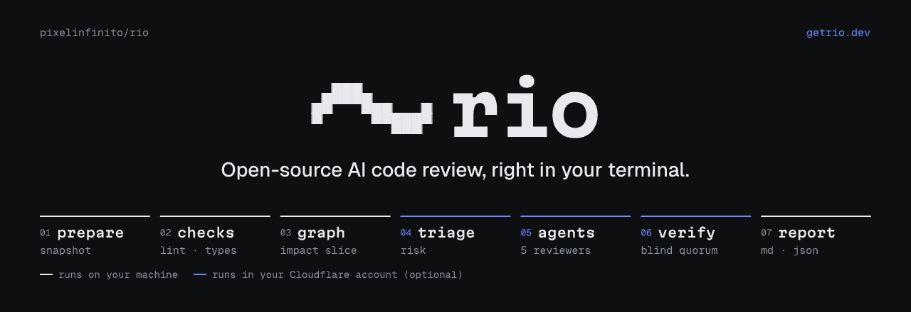

<p align="center"></p>

Rio reviews Git changes with TypeScript, Python and Rust type checking, linting, secret scanning, diff coverage, dependency auditing, and a bounded impact graph. Run deterministic checks locally, or configure the Cloudflare endpoint for isolated checks and agent review with independent verifier voters. Rio is licensed under Apache-2.0.

The original [automated acceptance evaluation](docs/evaluation/v0.1.md) concluded **no-go**. A [methodology-corrected rescoring](docs/evaluation/v0.1-rescored.md) finds **insufficient evidence** because all ten PRs lacked working baseline classification; stable v0.1 release remains blocked. The implementation and release-candidate validation are available; the commands below describe published release installation.

## Install

Release installers verify SHA-256 checksums before executing the binary. Linux binaries use musl; macOS and Windows binaries are available for x64 and arm64.

```sh
curl -fsSL https://github.com/pixelinfinito/rio/releases/latest/download/install.sh | sh
```

To inspect the installer first:

```sh
curl -fsSL https://github.com/pixelinfinito/rio/releases/latest/download/install.sh -o install.sh
less install.sh
sh install.sh --version v0.1.0 --install-dir "$HOME/.local/bin"
```

On Windows, in PowerShell 5.1 or 7:

```powershell
irm https://github.com/pixelinfinito/rio/releases/latest/download/install.ps1 | iex
```

To inspect it first:

```powershell
Invoke-WebRequest https://github.com/pixelinfinito/rio/releases/latest/download/install.ps1 -OutFile install.ps1
Get-Content install.ps1
.\install.ps1 -Version v0.1.0 -NoModifyPath
```

Unix defaults to `~/.local/bin` and prints a PATH hint without changing shell files. Windows defaults to `%LOCALAPPDATA%\Programs\rio\bin` and adds that exact directory to the user PATH; `-NoModifyPath` or `RIO_NO_MODIFY_PATH=1` opts out. Both installers accept `RIO_VERSION`, `RIO_INSTALL_DIR`, `RIO_UNINSTALL=1`, `RIO_PURGE=1`, and `RIO_DOWNLOAD_BASE` (an HTTPS directory URL or local directory containing archives and `SHA256SUMS`). Flags override environment values. For a local directory with one matching archive, no version flag is needed. Test overrides `RIO_INSTALL_OS` and `RIO_INSTALL_ARCH` control platform detection.

For provenance verification, download the archive for your target and run:

```sh
gh attestation verify rio-0.1.0-x86_64-unknown-linux-musl.tar.gz --repo pixelinfinito/rio
```

Checksums detect corruption; attestations connect artifacts to the release build. Stable releases become latest; release candidates do not.

To build from source, install the Rust version in `rust-toolchain.toml`, then:

```sh
cargo install --path crates/rio-cli --locked
rio --version
```

The version output includes the version, target triple and build commit. Set `RIO_BUILD_VERSION` to override the compiled release version, and `RIO_BUILD_COMMIT` when building from a source archive without Git metadata.

## Review changes

Install your project's dependencies and tools first. Rio never installs them for you.

```sh
rio doctor
rio review                       # working tree, staged changes and untracked files against HEAD
rio review --staged              # index against HEAD
rio review --base origin/main    # committed HEAD against merge base
rio review --format json > report.json
rio review --format md > report.md
rio review --format sarif > rio.sarif
rio review --offline --no-color
rio review --show-pre-existing
```

Selection flags are mutually exclusive. Typecheck runs over each affected project, lint over changed files, and tests run for coverage. In workspaces, dependent roots also receive typecheck and coverage. Reports identify every check that passed, found issues, failed, was skipped or was cancelled. An incomplete review with no findings names the unfinished checks.

The first Ctrl-C terminates tool process trees and keeps a partial report. A second Ctrl-C kills remaining process groups or Windows jobs and exits 130 without emitting a JSON or Markdown document. JSON writes one final schema-validated document; progress and warnings go to stderr. SARIF follows the same rules: one SARIF 2.1.0 log on stdout for every exit after argument parsing, including exits 2 and 3, where the log has no results and its invocation carries the error (see [the SARIF mapping](docs/sarif-mapping.md)), so `rio review --format sarif > rio.sarif` can feed a code-scanning upload. Markdown also keeps progress on stderr. Terminal mode streams progress and check outcomes. `NO_COLOR`, `--no-color`, and redirected stdout disable color.

TypeScript tools are `tsc`, ESLint, Vitest or Jest. Python tools are Pyright or mypy, Ruff, pytest and coverage.py. Rust uses installed Cargo/toolchain components for `cargo check`, configured Clippy/rustfmt checks, and optional `cargo llvm-cov` coverage. Rust member changes check each scheduled member and its dependents; workspace-wide changes check the workspace. Project-local executables take precedence over PATH. See [adapter details](docs/adapters.md).

Without an endpoint, deterministic checks and the graph run locally; agent, triage and verifier steps are deferred with `no_endpoint`. A configured endpoint captures immutable base/head snapshots and runs checks remotely in a Cloudflare Container or self-hosted Docker runner. It adds risk triage, independent agents and blind verifier quorum, with audit evidence cached alongside the report.

```sh
cf auth login
# Supply OPENROUTER_API_KEY through your private environment or --secrets-file.
rio init
rio review --profile rio/openrouter --preset standard
rio deploy # upgrade the paired Worker in your own account
rio review --preset quick
rio review --deep
```

Instead of OpenRouter, `rio init` can register your own OpenAI-compatible or Anthropic endpoints as AI Gateway custom providers (provider 4, or `--custom-provider SLUG:PROTOCOL:BASE_URL` with the key in `AI_GATEWAY_PROVIDER_KEY_<SLUG>`), and profiles can call them as `custom-SLUG/MODEL`, through the unified `compat/…` endpoint, or through gateway dynamic routes as `dynamic/ROUTE`; see [custom endpoints](docs/cloudflare.md#custom-endpoints-through-ai-gateway). Quick, Standard and Deep require an endpoint; `--offline` keeps local deterministic execution. PR fetching and publication (`--pr`, `--publish`) remain unsupported. An enabled security step (or `--profile rio/security`) reviews the change against the OWASP Top 10:2025 or ASVS 5.0 catalog and reports which catalog items it assessed. See [Cloudflare deployment and runners](docs/cloudflare.md) and [verification evidence](docs/verifier-contracts.md) for setup, isolation, budgets and the pending live model acceptance gate.

### Review lineages and feedback

```sh
rio review --since-last                  # next round of this branch's lineage
rio review --since-last --reset-lineage  # new generation, back to round 1
rio feedback 8c1e --dismiss intentional --note "documented behavior"
```

`--since-last` reviews the current branch as a lineage held by the endpoint; it needs a configured endpoint and online mode (otherwise exit 2) and a checked-out branch (a detached HEAD exits 2). The lineage is keyed by the normalized `origin` URL (scheme, credentials, port and `.git` removed), or the repository directory name without an `origin`, plus the branch name, so rebases and force-pushes keep it. The endpoint assigns the round, re-reviews only the diff since the previous head after the first round, holds back findings it already posted and, once the round exceeds `rounds.cap`, summarizes unresolved findings in a "reconsider" message. Reports always list every finding, so `fail_on` and exit codes are unchanged; the footer shows the round and cap state, the author-response ratio when answers exist and the held-back count, and already-posted findings are marked. Rio keeps a versioned copy of the endpoint's lineage state at `<cache>/lineages/<hash>.json`. It is a cache: a missing copy is refetched from the endpoint, never treated as a reset, and it is pruned with the rest of the review cache. Only `--reset-lineage` (which requires `--since-last`) starts a new generation.

`rio feedback <id> --dismiss <reason> [--note TEXT]` answers a posted finding through the endpoint. Accepted reasons are `fixed`, `wrong`, `intentional`, `irrelevant` and `style`; any other reason exits 2 before contacting the endpoint. The actor is your `git config user.email` when set. It exits 0 when the response is recorded, 2 for an invalid reason, a missing endpoint or a missing API token, and 3 when the endpoint rejects the response or does not know the finding. A dismissal never changes posture, budgets, rules or suppressions.

### Finding history and suppression proposals

```sh
rio findings --status dismissed              # the repository's finding registry
rio review --show-remembered                 # also list remembered dismissals
rio suppressions list
rio suppressions apply sp-3f2a9c1b7d4e       # asks before editing .rio/profiles/default.yaml
rio suppressions decline sp-3f2a9c1b7d4e --note "we want these"
```

With an endpoint, every review updates a per-repository registry of finding identities (keyed like `--since-last` lineages: the normalized `origin`, else the directory name). A finding dismissed `intentional`, `irrelevant` or `style` is remembered while its enclosing symbol is unchanged: later reviews leave it out of the findings, risks and security sections and count it in the footer with the reason and where it was dismissed; `--show-remembered` lists those findings in their own section without changing the exit code. A `wrong` dismissal is never remembered: the recurrence is reported with a history line naming the earlier answer, and a finding recorded fixed that comes back is labelled a regression. `rio findings [--status open|fixed|dismissed] [--rule RULE] [--since TIMESTAMP] [--format json]` lists the registry; it exits 2 without an endpoint.

Repeated `irrelevant` or `style` dismissals (three by default within 90 days, `proposal_threshold` on `rio/report`) of one rule, or of differing rules under one directory, become suppression proposals listed in the report footer. Nothing is suppressed until you apply one: `rio suppressions apply <id>` prints the entry and its evidence, asks for confirmation (or `--yes`), appends the entry under `suppress` in `.rio/profiles/default.yaml` (creating it, extending `rio/base`, when absent), writes and validates the result in a temporary file next to it before replacing the profile (a failed write or validation leaves the original byte for byte unchanged), and marks the proposal applied. Answering anything but `y` leaves the file and the proposal unchanged and exits 1. `rio suppressions decline <id> [--note TEXT]` stops the entry from being proposed again for 180 days. `rio suppressions list [--status S] [--format json]` shows every proposal with its evidence count. Commit the profile change with your code; the endpoint never writes repository files.

The endpoint also caches agent hypotheses per changed hunk and context, so an unchanged hunk in a later round, branch or pull request is not sent to the model again; replayed hypotheses are still verified and are marked `cached`. The footer shows the hit rate; `with: {cache: false}` on `rio/agents` turns the cache off. See [finding history, proposals, SARIF and the agent cache](docs/finding-history.md).

When resolved dependency versions change, Rio sends the changed package names, ecosystems and versions to `https://api.osv.dev/v1/querybatch` and `/v1/query`, then fetches advisory details from `/v1/vulns/<id>`. It caches advisory records. `--offline` prevents network requests by Rio. Tools, plugins and project tests are **not network-isolated**; reports say so when an offline review executes a subprocess. Use external network isolation to block their network access as well.

## Profiles

```sh
rio profile list
rio profile show rio/base
rio profile show strict --raw
rio profile validate
rio review --profile strict
```

Defaults resolve from `.rio/profiles/default.yaml`, then the personal `profiles/default.yaml`, then built-in `rio/base`. Named profiles and explicit file paths are supported. To disable coverage, save this as `.rio/profiles/default.yaml`:

```yaml
version: 1
name: quick
extends: rio/base
steps:
  - id: prepare
    uses: rio/prepare
  - id: checks
    uses: rio/checks
    needs: [prepare]
    with:
      coverage: false
  - id: graph
    uses: rio/graph
    needs: [prepare]
  - id: report
    uses: rio/report
    needs: [checks, graph]
```

Lists replace inherited lists, so this profile explicitly lists all desired steps. [The profile reference](docs/profiles.md) documents inheritance, all schema keys, budgets, exclusions, suppressions and policy.

Rio checks the selected source's lockfile against installed dependency metadata. A stale or incompatible installation skips tool checks with `dependency_mismatch`. If metadata cannot establish compatibility, `with: {trust_installed_dependencies: true}` on `rio/checks` permits using the installed dependencies. This cannot override a known mismatch. Trusted results are labelled `trusted`. Rio compares head and base using the same installation unless the base has a known mismatch. When a baseline is unavailable, diagnostics outside changed hunks (with three lines of context) are treated as pre-existing and hidden unless `--show-pre-existing` is set.

## Exit codes

| Code | Meaning |
| --- | --- |
| 0 | No policy failure; optional missing tools may still make the report incomplete |
| 1 | A finding matches the general or security failure policy |
| 2 | Usage, configuration or profile error |
| 3 | Repository state prevents review, or an internal/persistence error aborts it |
| 4 | A review is partial, a check failed or was cancelled under `fail_on.incomplete`, or a required check was skipped |
| 130 | Second interrupt |

The default policy fails on new or worsened defects with `static_proven` or stronger evidence. It ignores pre-existing findings and risks. A missing optional tool is a skip and does not itself fail the command. Set `fail_on.required_checks: [typecheck, lint]` to require those checks, or `fail_on.incomplete: false` to stop incomplete analysis from producing exit 4. A matching finding takes precedence over exit 4.

## Machine configuration

Machine settings come only from user configuration, environment variables and supported command flags. Rio never reads machine settings from a cloned repository. The configuration directory is `RIO_CONFIG_DIR`, then `$XDG_CONFIG_HOME/rio`, then `~/.config/rio` on Linux/macOS or `%APPDATA%\rio` on Windows. It holds `config.toml` and personal `profiles/`.

| TOML key | Environment variable | Default |
| --- | --- | --- |
| `endpoint.url` | `RIO_ENDPOINT_URL` | unset; noticed only |
| `cache.dir` | `RIO_CACHE_DIR` | `<repository>/.rio/cache` |
| `cache.max_age` | `RIO_CACHE_MAX_AGE` | `30d` |
| `cache.max_size` | `RIO_CACHE_MAX_SIZE` | `5GiB` |
| `cache.retain_raw_output` | `RIO_CACHE_RETAIN_RAW_OUTPUT` | `true` |
| `run.parallelism` | `RIO_PARALLELISM` | physical cores, at most 4 |
| `run.output_limit` | `RIO_OUTPUT_LIMIT` | `256MiB` per tool stream |

Environment values override the file; flags override matching settings. Unknown keys and invalid values exit 2 and name the source. Example:

```toml
[cache]
max_age = "7d"
max_size = "2GiB"
retain_raw_output = false
[run]
parallelism = 2
output_limit = "128MiB"
```

`rio doctor --format json` shows effective values and their sources, the roots scheduled for the current diff, tools, dependency compatibility, the shared review plan, cache writability and free space. A clean diff schedules no root probes. Use `rio doctor --all-roots` to inspect every project; progress for each root is printed to stderr. With `--base <sha>`, both modes verify dependencies and determine baseline availability against the selected base exactly as review does. `--all-roots` extends these checks to roots outside the current diff while preserving that base. Each root reports the repository-relative head `lockfile` and `base_lockfile` used for verification (`null` when no governing lockfile exists in that tree). It exits 1 for blocking configuration, profile, repository or cache problems; missing tools are warnings.

## Cache and supported Git states

The cache contains source snapshots, pure extracted source trees, resolved profiles, parsed findings, graph slices and redacted tool output. Treat it as sensitive as the repository. Cached trees never receive installation links. Each tool runs in its own disposable source copy with links to the current worktree's ignored dependency installation. Separate worktrees can share cached source while using their own installations. Tools rewriting source cannot modify the cached source tree. Rio never hard-links writable tool source to cached source.

Run records live at `<cache>/<review-id>/runs/<run-id>/`; `latest` names the most recently finished run. Review IDs identify the snapshot and resolved profile; each execution gets a distinct run ID. Shared entries publish atomically under locks; live references protect them during pruning. Age, reachability and LRU size rules control retention; local lineage copies under `<cache>/lineages/` expire by age and are evicted by size like other entries. Unix cache directories use mode 0700 and files 0600; Windows inherits the containing directory's ACL. Raw streams are redacted, capped at 16MiB each with head and tail retained, and can be disabled with `cache.retain_raw_output`. Source snapshots themselves retain source content, including any secrets present there.

Working trees, indexes, branch merge bases, untracked non-ignored files, unborn HEAD, linked worktrees and sparse checkout are supported. Conflicted indexes are refused for working-tree and staged reviews. Bare repositories are refused. Shallow branch reviews need enough history for a merge base; fetch deeper history or unshallow. Partial clones need the selected objects available locally; Rio does not fetch missing promised blobs. Hydrate the required history before reviewing. Submodules are recorded as gitlinks, not recursively reviewed. LFS pointers stay pointers. Unsafe paths, symlink traversal and case collisions on insensitive filesystems are rejected. macOS cannot reliably track descendants that escape a process group with `setsid`; Windows review features remain best effort, with tools supervised in Job Objects.

## Uninstall

```sh
sh install.sh --uninstall           # keep personal configuration
sh install.sh --uninstall --purge   # also remove configuration
```

```powershell
.\install.ps1 -Uninstall
.\install.ps1 -Uninstall -Purge
```

The installers remove only Rio binaries/staging files, leave other files and the install directory, and print the kept configuration path. Windows also removes only the exact Rio user-PATH entry. Remove each repository's `.rio/cache` manually, or your configured `cache.dir`; uninstall does not search the disk for caches. Source installs can be removed with `cargo uninstall rio-cli`.

## Development

```sh
cargo fmt --all --check
cargo clippy --workspace --all-targets
cargo test --workspace
python3 -m unittest discover -s tests/installers -v
```

Tool-dependent tests print a skip reason when fixture tools are absent. `RIO_REQUIRE_TOOLS=1` turns such skips into failures. CI installs the fixture toolchains. [Release validation](docs/release-checklist.md) tracks platform tests and the independent automated acceptance evaluation required before stable release.
