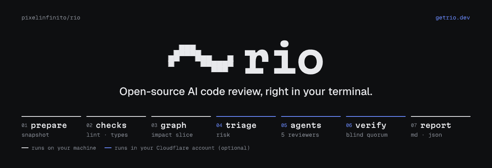
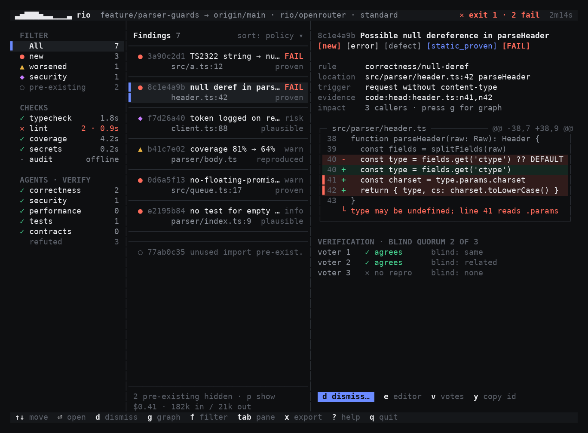

<p align="center"></p>

# Own your AI review pipeline.

**Rio is an open-source alternative to CodeRabbit and Greptile, with code review in your terminal and infrastructure you control.**

Review local changes before you push. Bring AI reviewers into your workflow. Automate pull request reviews for your team. Choose the models, checks, and rules that fit your codebase.

Start with local checks—no cloud account or API key needed. Add hosted AI review when you're ready.

**[Get started](#get-started)** · [Explore the Wiki](https://github.com/pixelinfinito/rio/wiki) · [Português (Brasil)](https://github.com/pixelinfinito/rio/wiki/PT-BR-Start)

⭐ **Want code review you can inspect and control? [Give Rio a star](https://github.com/pixelinfinito/rio)** to help others discover it.

## Why Rio?

- **Review before the pull request.** Check uncommitted edits, staged files, or a whole branch from your terminal. Connect GitHub when you want automatic PR reviews.
- **See the evidence.** Bring project checks, findings, and changed lines together. With AI enabled, independent verifiers assess the issues reviewers propose.
- **Choose your models.** Use supported providers or your own compatible endpoints. Set review depth and budgets for your team.
- **Keep control of the pipeline.** Run the backend in your own Cloudflare account, choose the runner, and keep review policy alongside your code. Rio is Apache-2.0 licensed.
- **Carry feedback forward.** Track findings across review rounds and remember dismissals on unchanged code, so your team can focus on what needs attention.
- **Review the experience, too.** Optional browser QA exercises user journeys and collects functional, accessibility, and UX evidence.

## See your code review in context



*A branch review with hosted AI enabled. Demo data from Rio's actual terminal renderer. [Read the screen as text](docs/wiki/assets/review-02-findings.txt) · [Explore the terminal UI](https://github.com/pixelinfinito/rio/wiki/EN-Tui)*

## Get started

### 1. Install Rio

Rio is in active development. There are no published releases yet; build from source to try it today. Install [Rust with rustup](https://rustup.rs/) and Git, then run:

```sh
git clone https://github.com/pixelinfinito/rio.git
cd rio
cargo install --path crates/rio-cli --locked
rio --version
```

The checkout selects the required Rust toolchain. [Installation guide →](https://github.com/pixelinfinito/rio/wiki/EN-Installation)

### 2. Review your changes

Open your own Git project in a terminal, install its dependencies, and make a change. Then:

```sh
rio doctor     # See which checks are ready
rio review     # Review your local changes
```

Rio uses your project's tools, with built-in support for **TypeScript, Python, and Rust**. You can inspect findings and evidence in the terminal UI, or use `rio review --no-tui` for plain output. Missing tools and skipped checks are shown in the report.

Choose what to review:

| Your workflow | Command |
| --- | --- |
| Everything you changed locally | `rio review` |
| Only staged changes | `rio review --staged` |
| Your branch against `origin/main` | `rio review --base origin/main` |
| A GitHub pull request, after endpoint and App setup | `rio review --pr 123` |

[Walk through your first review →](https://github.com/pixelinfinito/rio/wiki/EN-Review)

### 3. Make it yours

[Choose what Rio checks](https://github.com/pixelinfinito/rio/wiki/EN-Profiles), [understand a finding](https://github.com/pixelinfinito/rio/wiki/EN-Results), or [connect it to CI](https://github.com/pixelinfinito/rio/wiki/EN-Ci). Export JSON, Markdown, or SARIF when another tool needs the results.

## Bring your own AI

Run AI review through an endpoint in your own Cloudflare account, or connect to one your team already runs. Choose your provider, configure credentials, and let `rio init` guide setup. Provider and infrastructure usage are billed to your accounts.

With the endpoint ready:

```sh
rio review --profile rio/openrouter --preset standard
```

This example uses an OpenRouter profile; other supported providers and compatible endpoints work through their own profiles and routes. You control model selection, budgets, and which findings affect review policy.

Add the GitHub App for reviews on PR opening and updates, or request a PR review from your terminal. Your repository policy determines when Rio posts comments.

**[Set up AI review](https://github.com/pixelinfinito/rio/wiki/EN-Hosting)** · [Choose providers](https://github.com/pixelinfinito/rio/wiki/EN-Providers) · [Connect GitHub](https://github.com/pixelinfinito/rio/wiki/EN-Github)

## Go beyond code changes

**Browser QA:** test user journeys across screen sizes and themes, then inspect screenshots and other evidence. Requires a Linux Docker host, model access, and app setup. [Start with browser QA →](https://github.com/pixelinfinito/rio/wiki/EN-Qa)

**Coding agents:** let your agent read concise, version-matched documentation directly from the binary—offline, without browsing a website.

```sh
rio docs
rio docs search "profiles"
rio docs profiles --section inheritance
```

[Learn about embedded agent docs →](https://github.com/pixelinfinito/rio/wiki/EN-Docs)

## Learn more and get involved

- [All guides](https://github.com/pixelinfinito/rio/wiki/EN-Guides) · [Commands and settings](https://github.com/pixelinfinito/rio/wiki/EN-Reference) · [Troubleshooting](https://github.com/pixelinfinito/rio/wiki/EN-Troubleshooting)
- [Documentação em português do Brasil](https://github.com/pixelinfinito/rio/wiki/PT-BR-Start)
- [Report a bug or suggest an improvement](https://github.com/pixelinfinito/rio/issues)
- [Contributor and evaluation guide](https://github.com/pixelinfinito/rio/wiki/EN-Evaluation) · [Release checklist](docs/release-checklist.md) · [Apache-2.0 license](LICENSE)

Rio's stable-release quality gate is still open. The [evaluation record](docs/evaluation/v0.1-rescored.md) explains the remaining evidence gaps. Try it on real changes, inspect the findings, and help us improve it.
