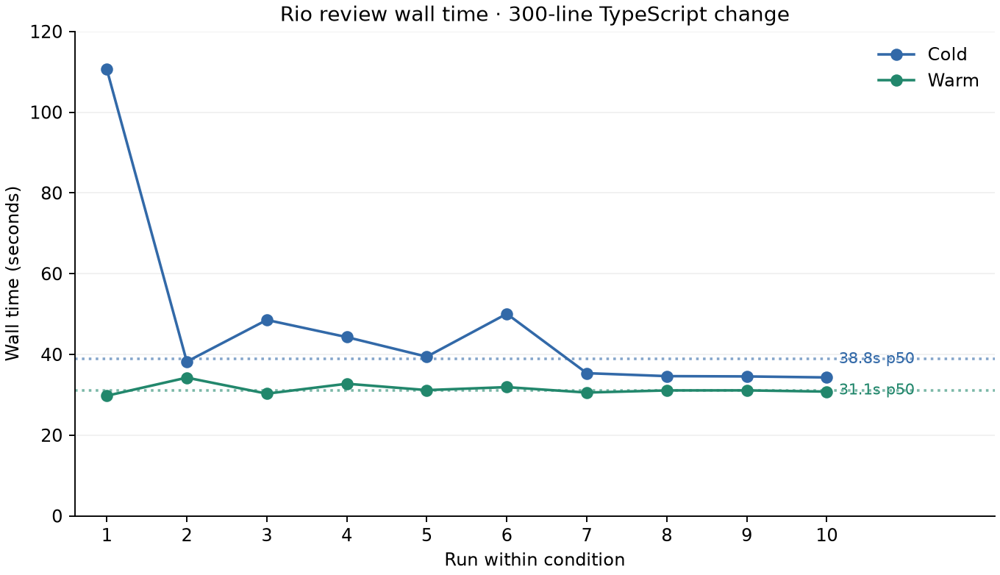

# Rio v0.1 local benchmark

Fast-mode reviews of a committed **300-line addition** in [gvergnaud/ts-pattern](https://github.com/gvergnaud/ts-pattern). Upstream contains 83 TypeScript files and 19,211 TypeScript lines before the benchmark addition. The benchmark adds an exported typed lookup table in `src/rio-benchmark.ts`; upstream configuration, tests, dependency declarations and lockfile remain unchanged.

Base: `f11be73acb18e1d653d4f252e7d75981d873a2e6`. Benchmark head: `58b0b15b613877f6a879ebae48a67b4752310bae`. The head commit is local. Apply the preserved [change.patch](benchmark-data/change.patch) on that upstream base and commit it to reproduce the exact 300-line addition.

Platform: `Linux-6.8.0-147-generic-x86_64-with-glibc2.39`; 20 logical CPUs. Dependencies were installed with `npm ci --ignore-scripts`: Node v26.13.0, npm 12.2.1, Version 5.9.2, Jest 30.1.2. Rio command: `rio review --base benchmark-base --offline --format json`, built in release mode. Binary: `rio 0.1.0 x86_64-unknown-linux-gnu ce0eb3825675`; SHA-256 `9aef7d6352d3cfe78b164fafbee721c699c1e90a08967879ef051e8d2e75aa82`.

The binary was compiled from the implementation working tree before commit `8ea5d63`; its build commit label therefore names the preceding planning commit. The binary digest identifies the measured executable. Concurrent fixture tests, compilation and one real-PR review affected early cold runs; all observations, including the 111-second first-run outlier, are retained. These are local measurements, not a controlled CI performance claim.

Ten cold runs each start with an empty dedicated cache. Ten warm runs reuse the final cold cache. All ten warm runs reused the baseline typecheck, and cached source materializations were retained. Project tests still run on every review. Wall time is measured around the CLI process, including setup, graph, serialization and cache publication. p50 is the median; p95 uses linear interpolation at `(n-1)*0.95`.

| Condition | Runs | Wall p50 | Wall p95 |
| --- | ---: | ---: | ---: |
| cold | 10 | 38.824s | 83.377s |
| warm | 10 | 31.086s | 33.566s |

The cold p50 is 38.824 seconds, below the four-minute acceptance threshold.



## Per-check times

Times overlap because checks run concurrently, so their sum is not the wall time. The baseline is the second typecheck, not a repeated head measurement.

| Condition | Check / version | p50 | p95 | Outcome |
| --- | --- | ---: | ---: | --- |
| cold | coverage / head | 32.209s | 47.635s | passed |
| cold | dependencies / head | 0.208s | 0.391s | skipped: offline |
| cold | lint / head | 0.000s | 0.000s | skipped: no_project_config |
| cold | secrets / head | 0.000s | 0.000s | passed |
| cold | typecheck / base | 6.321s | 48.926s | passed |
| cold | typecheck / head | 8.533s | 15.379s | passed |
| warm | coverage / head | 29.465s | 31.831s | passed |
| warm | dependencies / head | 0.219s | 0.226s | skipped: offline |
| warm | lint / head | 0.000s | 0.000s | skipped: no_project_config |
| warm | secrets / head | 0.000s | 0.000s | passed |
| warm | typecheck / base | 0.000s | 0.000s | passed (cached) |
| warm | typecheck / head | 6.852s | 9.015s | passed |

Coverage and both non-cached typechecks completed in every run. The repository has no supported ESLint configuration, so lint was explicitly skipped. Offline mode explicitly skipped OSV auditing and makes the overall report incomplete; all runs exited 0 under the default optional-skip policy. This benchmark does not measure ESLint or network performance, and it does not establish semantic review usefulness.

## Reproduction and raw measurements

Use the pinned base, frozen dependencies, the described committed addition, and the exact release binary digest above. Then run:

```sh
python3 scripts/benchmark.py --repository /path/to/ts-pattern \
  --base benchmark-base --binary /path/to/rio --output /tmp/rio-benchmark --runs 10
```

[Machine-readable measurements](benchmark-data/v0.1.json) preserve every run, exit/status, review ID, per-check outcome/timing and cached flag. The script also keeps the complete JSON reports and stderr logs in the selected output directory.
