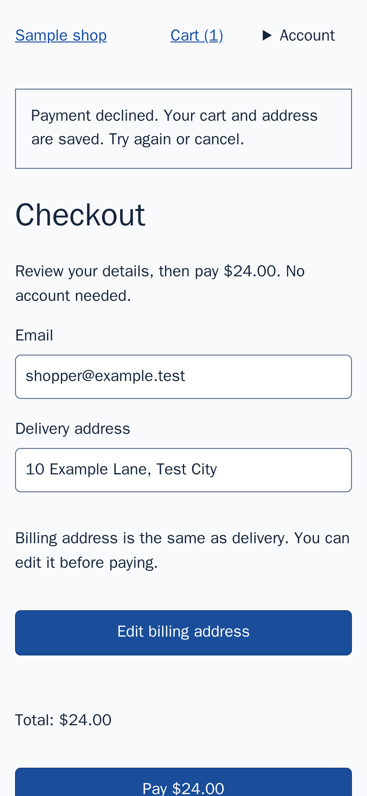

# Recovery recommendation human review

The project owner's assessment is recorded below. This is a real local Codex result from the
`missing-cancel` fixture, mobile/light, run `01M70AGJSNSNGREMR3PP9M36MK`.
Recommendation: `440a1ecfc60c1b5600eb951abf49b937e8de17e5f9dda0acc7f7617b09e4125b`.
It remains unverified by the hosted quorum.

After a declined payment, the alert says **Try again or cancel**. The checkout
has a Pay button and a header Cart link, but no local cancel/back action.
The recommendation proposes **Back to cart** beside the decline message,
preserving the cart and address. It explicitly acknowledges that the header
already provides navigation and that another control adds clutter on mobile.
It does not claim the user is unable to cancel.

The stated benefit is: “May reduce effort to identify the cancellation path
after a decline.” The report says this expected benefit has not been tested.
`REVIEW.md` requires preserved work after a decline and a clear next action.

The retained DOM independently shows `Cart (1)` linking to `/cart`, the decline
alert, email/address inputs, Edit billing address, Total: $24.00, and Pay $24.00.
The form ends immediately after Pay; no cancellation control appears below it.
This avoids inferring absence solely from what fits in the screenshot.
The journey subsequently retried payment successfully.

Evidence IDs: screenshot
`1e7a026402cdcdfb2428900707f6909fa25f484f8e3a7676a9eaf1669ff3cc36`,
DOM `91c25646995ead56b58b1c54807b4c313ef30ac1ea73193010b4a35613e8b5ed`.

Score guidance adherence, relevance and actionability from 0 (absent) to
2 (clear), then answer whether it falsely claims a proven benefit (yes/no).
Human labels (project owner, 2026-11-09): **2, 2, 2; no**. The owner's
shorthand “2, no” was recorded as 2 for each quality dimension and no false
proven-benefit claim. Machine-readable labels are in `v0.3-qa-human-labels.json`.

Assistant assessment: the screenshot and DOM support a discoverability concern,
and the proposal acknowledges the existing alternative and its own trade-off.
This is not a human label or evidence of improved user outcomes.
