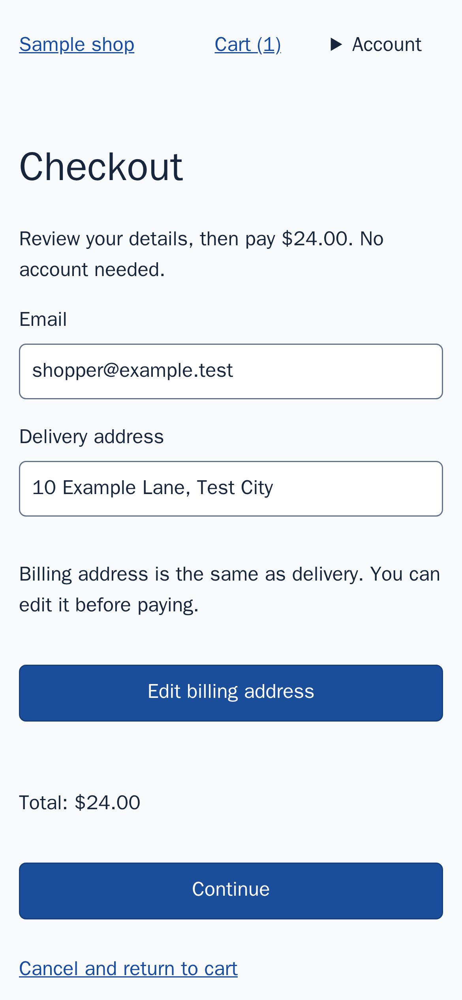

# QA recommendation human review

The project owner's assessment is recorded below. This is a real local Codex result from the
`ambiguous-next` fixture, mobile/light, run `01M707WHBFE4B0H5WSDK1AESSY`.
It remains unverified by the hosted quorum. The OpenSpec proposal requires human
labels; assistant assessment is kept separate and must not populate those fields.

Recommendation: `6dc1634162bfa78d57aefffe7d6cbf201b3db6ea589e37989aa7c91ea86ee516`

The checkout button says **Continue**, although activating it immediately completes
the purchase. The recommendation is to label it **Pay $24.00** or **Place order**.
It acknowledges that nearby text already says “Review your details, then pay
$24.00”, and that a longer button label needs more space.

Its stated benefit is: “Expected to clarify the payment commitment before activation.”
The report explicitly says that this benefit has not been tested.

The fixture's REVIEW.md requires a visible total before payment, clear confirmation
afterwards, and a clear next action. The recommendation cites Nielsen's usability
heuristics (1994), rather than asserting that its preferred wording is mandated.

Evidence before payment:



The recorded browser-click result contains this page state immediately afterwards
(this is browser tool output, not the model's explanation):

```text
- Page URL: http://app.test:4173/checkout
      - heading "Order confirmed" [active] [level=1] [ref=f3e25]
      - paragraph [ref=f3e26]: Order 1 is complete. A receipt will be sent to [redacted].
```

[Full sanitized browser transcript](/tmp/rio-qa-ux-acceptance/ambiguous-next/cache/dfd11f8ed78ca02e/runs/01M707WHBFE4B0H5WSDK1AESSY/qa/checkout/mobile-light/cell-transcript-4d927113aa1267cc.jsonl)

The second cited screenshot shows the empty cart after subsequent navigation,
not the transient confirmation screen. The trace was dropped by the then-current
CSS resource sanitizer; this limitation is retained in the evaluation record.

Score each dimension 0 (absent), 1 (partial), or 2 (clear):

- Guidance adherence: does it respect the applicable project requirements?
- Relevance: does it address an evidenced problem in this task?
- Actionability: is the proposed change concrete enough to implement?
- Unsupported benefit claim: yes/no — does it claim a benefit was proven?

Human labels (project owner, 2026-11-09): **2, 2, 2; no** — guidance adherence,
relevance, actionability, then a false proven-benefit claim. The owner initially
answered “yes” to the final field, then clarified that the stated benefit is
legitimate; the final label reflects that correction. It does not establish
measured user benefit.
Machine-readable labels are in `v0.3-qa-human-labels.json`, bound to this run and
recommendation. These scores do not establish hosted verification or tested benefit.

Assistant assessment: the screenshot and browser result support the label/action
mismatch, the wording is actionable, and the benefit is explicitly an expectation.
This assessment does not establish user testing, human labels, or hosted support.
