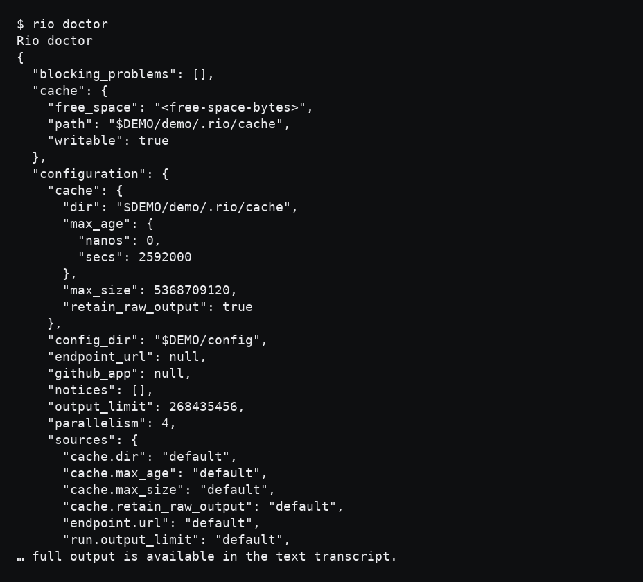

# Diagnose tools and readiness

## Outcome

Find out why a review would skip checks or fail before running the full review.

## Prerequisites

Run from your project. Install its dependencies first. Doctor shares the review planner and can probe tools, inspect cache readiness, and contact a configured endpoint.

## Steps

```sh
rio doctor
rio doctor --all-roots
rio doctor --base origin/main --format json
```

The default inspects roots affected by the working-tree diff. A clean diff schedules no root probes. `--all-roots` includes projects outside the diff; `--staged` and `--base REF` select the same comparisons as review. JSON lists values and their configuration sources, roots, tools, lockfiles, dependency compatibility, baseline availability, cache and readiness.

## Expected results

A found tool is not necessarily runnable for this snapshot: installed dependencies can disagree with the lockfile. Exit 0 means no blocking configuration/profile/repository/cache issue; missing tools are warnings. Exit 1 means a blocking issue. Doctor's codes differ from review's finding and incomplete-analysis codes.

## Troubleshooting

| Symptom | Recovery |
| --- | --- |
| Tool missing | Install the project's pinned checker/linter/coverage tool |
| `dependency_mismatch` | Recreate/synchronize the installation for the selected lockfile |
| Compatibility unknown | Inspect metadata; use `trust_installed_dependencies` only when justified |
| Cache not writable / low space | Check effective cache path and permissions; free space or change user config |
| Invalid profile | Run `rio profile validate` and fix named YAML paths |
| Missing GitHub installation | Install the App on the repository named by origin |

Trusting dependencies cannot override a known mismatch. Trusted diagnostics remain unclassified and do not receive normal baseline classification. `rio doctor --rotate` is a separate mutation: it rotates the GitHub App webhook secret and includes rollback handling. Do not use it for ordinary inspection.

## Next steps

[Fix configuration](configuration.md), then [run review](review.md).


## Screenshots



Read readiness warnings before interpreting a review. Demo data; captured from the current CLI/TUI renderer. [Text transcript](../assets/cli-doctor.txt).

<!-- commands:start -->

## Command reference

### `rio doctor`

| Argument | Meaning | Default / choices |
| --- | --- | --- |
| `--rotate` | Rotate the GitHub App webhook secret; this is a mutation. | `false` |
| `--all-roots` | Inspect all project roots, including unchanged ones. | `false` |
| `--staged` | Select only the index against HEAD; conflicts with --base. | `false` |
| `--base` | Compare committed HEAD against the merge base with this ref. | `—` |
| `--format` | Choose the output format; supported values are listed. | `terminal, json` |
| `--help` | Show command syntax and supported options. | `—` |

<!-- commands:end -->
