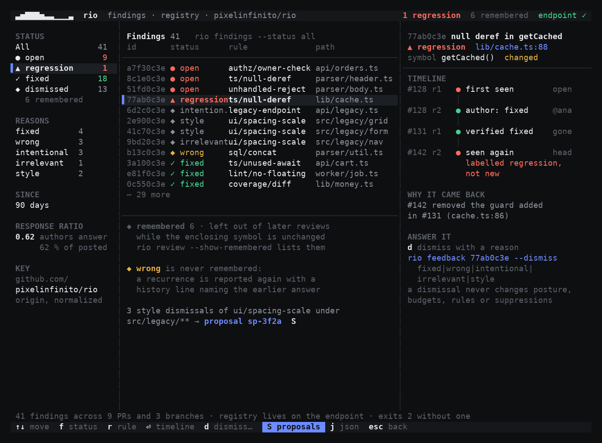

# Respond to findings and follow history

## Outcome

Explain what happened to a finding and avoid repeatedly reviewing the same issue without losing evidence of regressions.

## Prerequisites

Online endpoint, API token and a repository. Branch lineages require a checked-out branch, not detached HEAD. Feedback changes endpoint state; it does not change profile rules or automatically suppress code.

## Steps

```sh
rio review --since-last
rio findings --status dismissed --format json
rio feedback 8c1e4a9b --dismiss intentional --note "documented behavior"
```

Replace the example ID with a real displayed ID: at least eight characters, uniquely identifying a finding. Accepted reasons are `fixed`, `wrong`, `intentional`, `irrelevant`, `style`. Use `fixed` after repairing the problem, `wrong` when the diagnosis is incorrect, and explain intentional behavior in the note. The actor comes from `git config user.email` when available.

`--since-last` continues the branch's endpoint-owned lineage. `--reset-lineage` requires it and deliberately starts a new generation. Losing the local lineage cache does not reset rounds. The normalized origin URL and branch identify the lineage, so rebases preserve it. After the round cap, unresolved issues are summarized for reconsideration; report/failure policy still sees the findings.

## Expected results

Intentional/irrelevant/style dismissals are remembered while the enclosing symbol is unchanged. Wrong is not remembered; a recurrence references the earlier answer. A fixed finding that returns is a regression. `--show-remembered` lists remembered entries without changing policy.

`rio findings` filters by status, rule or `--since` RFC3339 timestamp. TUI `F` opens history. Feedback exits 0 when recorded, 2 for invalid inputs or missing endpoint/token, and 3 for rejected/missing/ambiguous IDs. Ambiguity returns candidate identities.

## Troubleshooting

A short or ambiguous ID must be expanded. An endpoint error does not justify changing local policy. In GitHub comments, `/rio dismiss ID REASON [note]` requires authorized collaborator/maintainer status and a finding from that PR's lineage.

## Next steps

[Inspect suppression proposals](suppressions.md) when repeated irrelevant/style findings indicate a policy adjustment.


## Screenshots



Inspect prior responses and finding lifecycle. Demo data · actual Rio renderer · [Text transcript](../assets/team-p3-finding-history.txt).

<!-- commands:start -->

<details>
<summary>All command options</summary>

## Command reference

### `rio feedback`

| Argument | Meaning | Default / choices |
| --- | --- | --- |
| `<id>` | Unambiguous finding ID prefix, at least 8 characters. | `—` |
| `--dismiss` | Record fixed, wrong, intentional, irrelevant or style feedback. | `—` |
| `--note` | Explanation to attach to finding feedback. | `—` |
| `--help` | Show command syntax and supported options. | `—` |
### `rio findings`

| Argument | Meaning | Default / choices |
| --- | --- | --- |
| `--status` | Filter lifecycle status using the listed accepted values. | `open, fixed, dismissed` |
| `--rule` | Filter findings by rule ID. | `—` |
| `--since` | Filter updates at or after this RFC3339 timestamp. | `—` |
| `--format` | Choose the output format; supported values are listed. | `terminal, json` |
| `--help` | Show command syntax and supported options. | `—` |

</details>

<!-- commands:end -->
