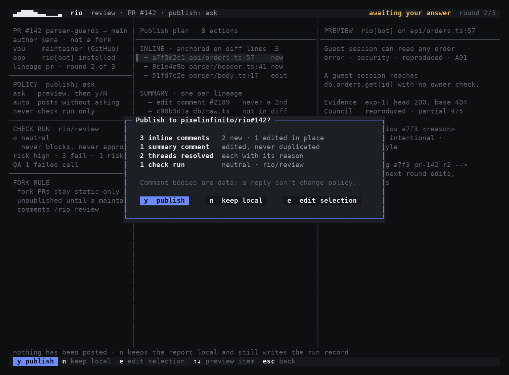

# Review pull requests with your team

## Outcome

Run hosted PR reviews and publish findings according to an explicit repository policy.

## Prerequisites

A configured endpoint, GitHub App installed on the origin repository, model routes, and a suitable runner. Fork PR execution needs the self-hosted runner. Publication writes comments/checks to GitHub.

## Steps

1. Run `rio init --github-app` after/alongside deployment; use `--github-org ORG` for organization ownership.
2. Complete GitHub's manifest registration and install the App on intended repositories.
3. Run `rio doctor` to check endpoint protocol and installation.
4. Commit the chosen default profile to the base branch, including model routes and `publish: ask`, `auto` or `never`.
5. Run `rio review --pr 123` with an actual PR number. With `ask`, inspect the preview and confirm, or deliberately supply `--publish` for automation.

Policy is read from the PR's merge base, so the change under review cannot grant itself publication privileges. `rio/base` uses `publish: never` and no models. Open/push events trigger review; authorized maintainers can comment `/rio review` to request a new round and reset the lineage.

## Expected results

Auto publishes eligible inline findings, a summary and a neutral `rio/review` check. Ask posts the check and waits for explicit publication authorization. The `never` policy posts no comments or checks. Fork publication also requires maintainer escalation. Later rounds update existing identity-marked comments and resolve fixed/dismissed threads.

The App uses contents read, PR/check write and metadata read; organization membership is read where applicable. A tightly scoped contents-write token is used only for each thread resolve/unresolve GraphQL mutation, then revoked. Tokens are not handed to the analysis container. See [CI](ci.md) for policy-aware gating: App checks are neutral.

## Troubleshooting

Inspect `report.publication` for reason/counts/URLs. Exit 5 means publication failed after an otherwise passing review; check existing comments before retrying. Dependencies absent from hosted snapshots can cause skipped checks; hosted execution does not install them.

`rio doctor --rotate` rotates the webhook secret. `rio init --replace-private-key FILE.pem` installs a new App key; verify it before removing the old key in GitHub. Installation warnings include an install URL. Protocol mismatches need paired CLI/Worker upgrades.

## Next steps

[Respond to findings](feedback.md), [manage suppressions](suppressions.md), or [integrate CI](ci.md).

## Screenshots

The current preview fixture still labels `never` as “check run only”; the endpoint actually posts neither comments nor checks for that policy. Follow the policy behavior above.

Review what will be published before confirming. Demo data; captured from the current CLI/TUI renderer. [Text transcript](../assets/team-p2-publish-preview.txt).

