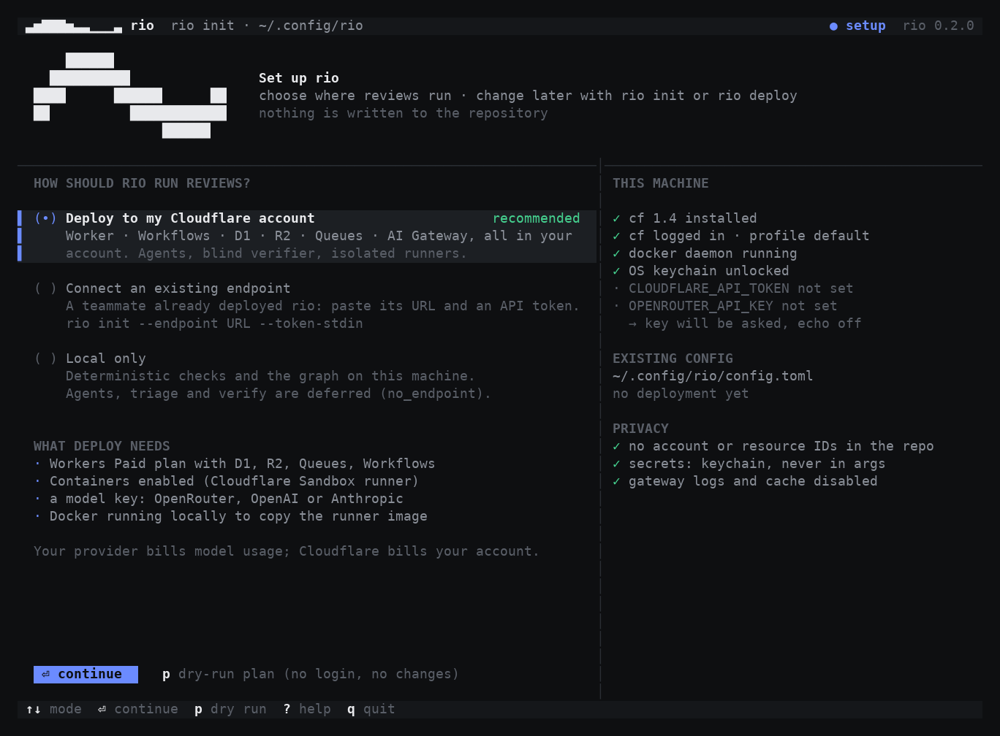
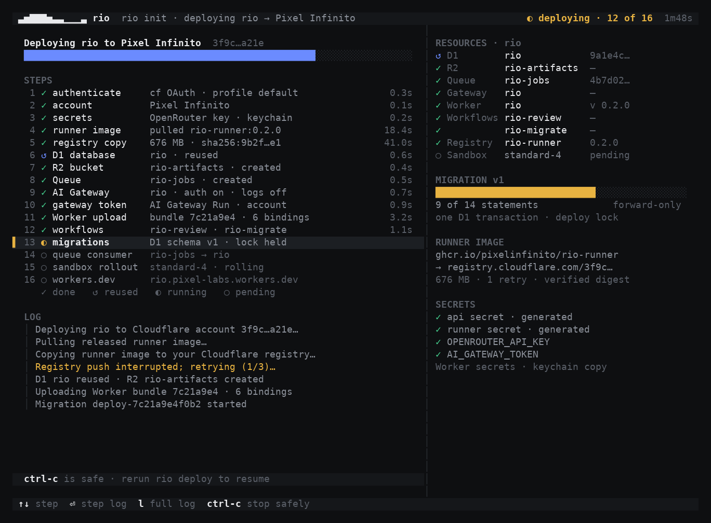

# Add AI review: connect or deploy

Host Rio’s backend in your own Cloudflare account, or connect to your team’s endpoint, to add AI reviewers and independent verification to CLI reviews. [Local checks](review.md) work without this setup.

## Outcome

Add model review and independent verification using infrastructure in your own account.

## Prerequisites

For an existing endpoint: its URL and API token. For a new deployment: Rio, Cloudflare's `cf` CLI/authentication (or `CLOUDFLARE_API_TOKEN`), eligible Workers/D1/R2/Queues/Containers services, and a model provider key. Sandbox deployment needs Docker running to copy the paired image into your registry. Self-hosted deployment does not require Docker on the deploying machine, but the runner host does need it. Resources/model calls may incur charges.

## Steps

### Connect to an endpoint your team already runs

Run `rio init --endpoint https://YOUR-ENDPOINT --token-stdin`, providing the token through a secret manager's stdin. Do not put it in the URL or shell arguments. Then run `rio doctor`.

### Deploy your own endpoint

```sh
cf auth login
# Supply OPENROUTER_API_KEY through your private environment.
rio init
rio review --profile rio/openrouter --preset standard
```

Setup selects account, name, runner and provider, then provisions the paired Worker, Workflows, D1, R2, queue, AI Gateway and optional Sandbox. It embeds the Worker: no source checkout/npm/Wrangler build is needed. `--no-tui` selects terminal prompts.

Use `rio deploy --dry-run` to inspect the offline plan without mutation. `rio init --runner self-hosted --account ACCOUNT_ID` chooses a Docker runner you operate. Configure that paired `rio-runner` host with endpoint and its separate runner secret; the [deployment reference](../../cloudflare.md#self-hosted-runner) contains the exact launch contract. Keep runner and CLI/Worker versions paired.

### Start a self-hosted runner

On a trusted Linux Docker host, check out the matching Rio source and supply `RIO_RUNNER_SECRET` (the endpoint’s `RUNNER_SECRET`) through a private environment. The `local` tag below names the image you build from that checkout; it is not a release version. Then run:

```sh
docker build -f worker/Dockerfile -t rio-runner:local .
RIO_ENDPOINT_URL=https://rio.YOUR-SUBDOMAIN.workers.dev \
  cargo run --locked -p rio-runner -- serve --image rio-runner:local
```

Keep this polling process running under your service manager. Do not mount the Docker socket, host workspace or credentials into analysis containers. The Docker host is trusted; dedicate it to running untrusted project code.

## Expected results

Choices persist under `[deployment]` in user `config.toml`; credentials use the OS keychain by default. `--credential-store file` explicitly selects private files for headless machines. `--from CONFIG` replays choices; `rio deploy` upgrades/reuses resources and resumes failed steps. Account/resource identifiers are not written into the project.

## Troubleshooting

Check cf profile/account and enabled services for deployment errors. Docker errors during Sandbox setup concern image transfer; self-hosted setup has a different requirement. A locked/unavailable keychain needs unlocking or an explicitly chosen file store. Rotate provider keys through private environment/secret files, then deploy. `--secrets-file` contains private JSON, not a repository file.

Setup asks which models review and verify: the form has `reviews` and `verifies` fields under the provider, and `--no-tui` asks for the reviewing and the verifying model. Each starts at the provider's default and takes a route as profiles write it (`PROVIDER/MODEL`). In scripted setup, `--default-model` and `--verifier-model` choose them. The choice is written when the personal default profile is first created; an existing `profiles/default.yaml` is never overwritten, so edit its `models` to change them later. The base profile has no models, so a successful endpoint deployment alone does not make every profile an AI profile. [Providers](providers.md) covers custom routes.

## Next steps

[Set model limits](budgets.md), [configure providers](providers.md), or [connect GitHub](github.md).


## Screenshots



Choose deployment or connection to an existing endpoint. Demo data · actual Rio renderer · [Text transcript](../assets/init-i1-choose-mode.txt).



Deployment exposes its current step and resource changes. Demo data · actual Rio renderer · [Text transcript](../assets/init-i3-deploying.txt).

<!-- commands:start -->

<details>
<summary>All command options</summary>

## Command reference

### `rio init`

| Argument | Meaning | Default / choices |
| --- | --- | --- |
| `--endpoint` | Connect this endpoint instead of provisioning infrastructure. | `—` |
| `--token-stdin` | Read the endpoint token from standard input; requires --endpoint. | `false` |
| `--github-app` | Register the GitHub App after deployment. | `false` |
| `--github-org` | Own the registered App under this organization. | `—` |
| `--replace-private-key` | Read a downloaded GitHub App PEM and update its endpoint secret. | `—` |
| `--no-tui` | Use terminal setup prompts instead of the interactive setup screen. | `false` |
| `--from` | Replay deployment choices from a saved user config file. | `—` |
| `--account` | Cloudflare account ID for deployment. | `—` |
| `--name` | Cloudflare resource-name prefix for this deployment. | `—` |
| `--cf-profile` | Select the cf authentication profile. | `—` |
| `--runner` | Choose Cloudflare Sandbox or self-hosted execution. | `sandbox, self-hosted` |
| `--runner-image` | Use this paired runner image. | `—` |
| `--workers-subdomain` | Select the account workers.dev subdomain. | `—` |
| `--credential-store` | Choose OS keychain or explicitly selected private files. | `keychain, file` |
| `--secrets-file` | Read provider credentials from private JSON; do not commit it. | `—` |
| `--custom-provider` | Register SLUG:PROTOCOL:BASE_URL; keys are supplied privately. | `—` |
| `--default-model` | Default model route for the generated profile. | `—` |
| `--verifier-model` | Select the verifier model route. | `—` |
| `--dry-run` | Show deployment plan without credentials or account changes. | `false` |
| `--council-vendor` | Opt in a council vendor as VENDOR:FAMILY:ROUTE; repeatable. | `—` |
| `--no-council` | Skip optional council setup. | `false` |
| `--help` | Show command syntax and supported options. | `—` |
### `rio deploy`

| Argument | Meaning | Default / choices |
| --- | --- | --- |
| `--from` | Replay deployment choices from a saved user config file. | `—` |
| `--account` | Cloudflare account ID for deployment. | `—` |
| `--name` | Cloudflare resource-name prefix for this deployment. | `—` |
| `--cf-profile` | Select the cf authentication profile. | `—` |
| `--runner` | Choose Cloudflare Sandbox or self-hosted execution. | `sandbox, self-hosted` |
| `--runner-image` | Use this paired runner image. | `—` |
| `--workers-subdomain` | Select the account workers.dev subdomain. | `—` |
| `--credential-store` | Choose OS keychain or explicitly selected private files. | `keychain, file` |
| `--secrets-file` | Read provider credentials from private JSON; do not commit it. | `—` |
| `--custom-provider` | Register SLUG:PROTOCOL:BASE_URL; keys are supplied privately. | `—` |
| `--default-model` | Default model route for the generated profile. | `—` |
| `--verifier-model` | Select the verifier model route. | `—` |
| `--dry-run` | Show deployment plan without credentials or account changes. | `false` |
| `--council-vendor` | Opt in a council vendor as VENDOR:FAMILY:ROUTE; repeatable. | `—` |
| `--no-council` | Skip optional council setup. | `false` |
| `--help` | Show command syntax and supported options. | `—` |

</details>

<!-- commands:end -->
