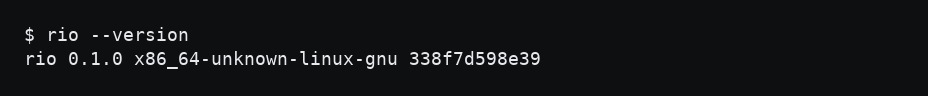
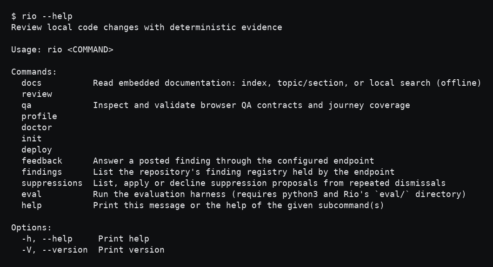

# Install, update and remove Rio

## Outcome

Install a verifiable binary, confirm which version is running, and know how to change or remove it.

## Prerequisites

Linux, macOS or Windows on x64/arm64; network access to GitHub releases. The latest-release URL only works when a suitable release is published. Source builds require the toolchain in `rust-toolchain.toml`.

## Steps

On Linux/macOS, download and inspect the installer before running it:

```sh
curl -fsSL https://github.com/pixelinfinito/rio/releases/latest/download/install.sh -o install.sh
less install.sh
sh install.sh
rio --version
```

On Windows PowerShell 5.1 or 7:

```powershell
Invoke-WebRequest https://github.com/pixelinfinito/rio/releases/latest/download/install.ps1 -OutFile install.ps1
Get-Content install.ps1
.\install.ps1
rio --version
```

Unix installs into `~/.local/bin` and prints a PATH hint without editing shell startup files. Windows defaults to `%LOCALAPPDATA%\Programs\rio\bin` and adds that directory to user PATH; open a new terminal. `-NoModifyPath` disables that change.

To pin a published tag, use `sh install.sh --version TAG --install-dir DIRECTORY` or `-Version TAG -InstallDir DIRECTORY`. Substitute actual values. `RIO_VERSION` and `RIO_INSTALL_DIR` are environment equivalents; flags win. Repeating installation upgrades or downgrades atomically after a smoke check. `RIO_DOWNLOAD_BASE` supports an HTTPS mirror or a local directory with archives and `SHA256SUMS`; checksums still apply.

From a source checkout: install the pinned Rust toolchain, then `cargo install --path crates/rio-cli --locked`. Builds from archives can set `RIO_BUILD_VERSION` and `RIO_BUILD_COMMIT` explicitly.

## Expected results

`rio --version` prints version, target triple and build commit. Installers verify SHA-256 before installing. To verify provenance of a downloaded archive, run `gh attestation verify ARCHIVE --repo pixelinfinito/rio` with its actual filename.

## Troubleshooting

Command not found: check installation directory and PATH. No latest release: choose an existing release tag or build from source; do not infer availability from example version numbers. Checksum mismatch: stop and redownload the archive/checksum pair from the same release.

Remove with `sh install.sh --uninstall` or `.\install.ps1 -Uninstall`; personal configuration is retained. Add `--purge`/`-Purge` only to delete that configuration too. Environment equivalents are `RIO_UNINSTALL=1` and `RIO_PURGE=1`. A source install is removed by `cargo uninstall rio-cli`. Repository caches require separate deliberate cleanup.

## Next steps

[Run your first local review](review.md).

## Screenshots



Confirm the installed version, target and commit. Demo data; captured from the current CLI/TUI renderer. [Text transcript](../assets/cli-version.txt).



Top-level help lists the available workflows. Demo data; captured from the current CLI/TUI renderer. [Text transcript](../assets/cli-help.txt).

