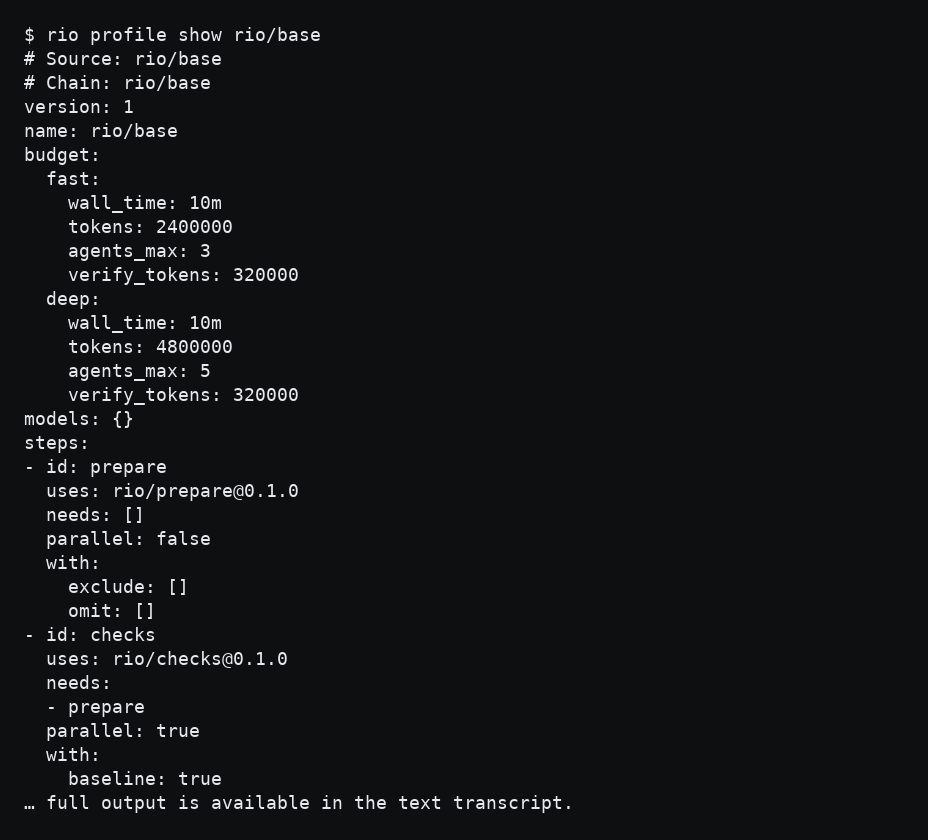

# Adjust checks with profiles

## Outcome

Change review behavior deliberately and validate it before running tools or models.

## Prerequisites

A project and a desired policy. Repository policy belongs in `.rio/profiles/default.yaml`; personal defaults live under the user configuration directory's `profiles/`. Credentials and machine limits belong in [machine configuration](configuration.md).

## Steps

```sh
rio profile list
rio profile show rio/base
rio profile show strict --raw
rio profile validate
```

Defaults resolve from repository, then personal default, then `rio/base`. Named profiles search repository/personal/built-in locations; explicit paths work too. `rio review --profile strict` selects a named profile.

### Require essential tools

Save this as `.rio/profiles/default.yaml`:

```yaml
version: 1
name: strict
extends: rio/base
fail_on:
  required_checks: [typecheck, lint]
```

Validate it with `rio profile validate`. Missing required tools now affect policy rather than being optional skips.

### Disable coverage for a small local workflow

Mappings merge, but **lists replace the inherited list**. This complete local pipeline intentionally keeps only prepare/checks/graph/report:

```yaml
version: 1
name: local-quick
extends: rio/base
steps:
  - id: prepare
    uses: rio/prepare
    with: {exclude: ['generated/**']}
  - id: checks
    uses: rio/checks
    needs: [prepare]
    with: {coverage: false}
  - id: graph
    uses: rio/graph
    needs: [prepare]
  - id: report
    uses: rio/report
    needs: [checks, graph]
```

For a hosted profile, start from its resolved steps and preserve the model/verification steps you want. Never paste only the modified checks step and assume the others remain.

## Expected results

`rio profile show` displays inheritance applied and module versions pinned. Validation exits 0 when valid, 2 on errors with YAML paths. It can warn that model steps will be deferred locally without rejecting a valid profile.

`fail_on.incomplete: false` changes incomplete-analysis exit policy; `suppress` accepts path/rule/exact-finding entries; `publish` controls never/ask/auto. Posture changes agent evidence/severity/caps: critical-only, balanced or thorough. [Budgets](budgets.md) limits resources; [module reference](modules.md) explains step options. Generated schema fields below/reference cover supported keys.

## Troubleshooting

Unknown modules, cycles in `extends` or `needs`, and unknown options fail validation. Lists replace, empty maps retain parent values, relative parent paths resolve from the declaring file. Inspect resolved YAML before running. Suppression removes findings from policy; it is not a repair of the code.

## Next steps

[Inspect module/schema fields](modules.md), [set model limits](budgets.md), or [use suppression proposals](suppressions.md).


## Screenshots



Inspect the resolved base profile before overriding steps. Demo data · actual Rio renderer · [Text transcript](../assets/cli-profile.txt).

<!-- commands:start -->

<details>
<summary>All command options</summary>

## Command reference

### `rio profile`

| Argument | Meaning | Default / choices |
| --- | --- | --- |
| `--help` | Show command syntax and supported options. | `—` |
### `rio profile list`

| Argument | Meaning | Default / choices |
| --- | --- | --- |
| `--help` | Show command syntax and supported options. | `—` |
### `rio profile show`

| Argument | Meaning | Default / choices |
| --- | --- | --- |
| `<reference>` | Profile name or YAML path to inspect. | `—` |
| `--raw` | Print authored profile without resolving inheritance. | `false` |
| `--help` | Show command syntax and supported options. | `—` |
### `rio profile validate`

| Argument | Meaning | Default / choices |
| --- | --- | --- |
| `<reference>` | Profile name or YAML path to validate; omit to validate the default profile. | `—` |
| `--help` | Show command syntax and supported options. | `—` |

</details>

<!-- commands:end -->
