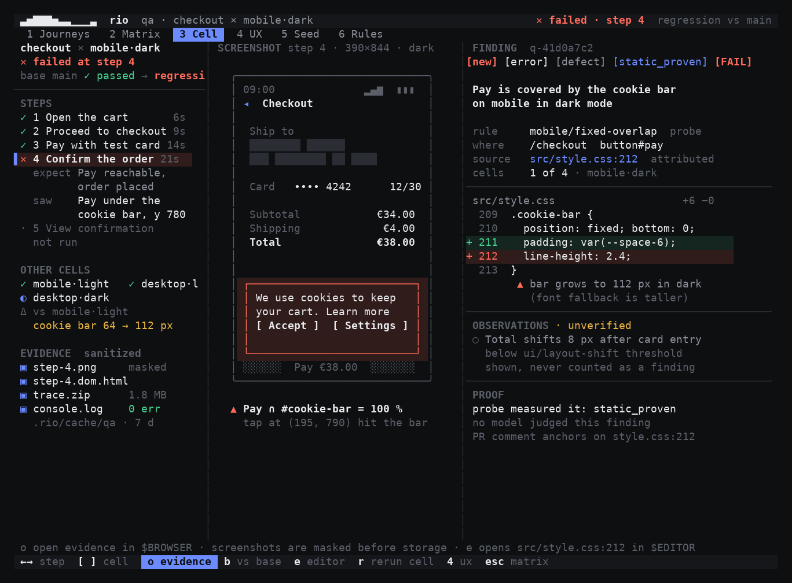
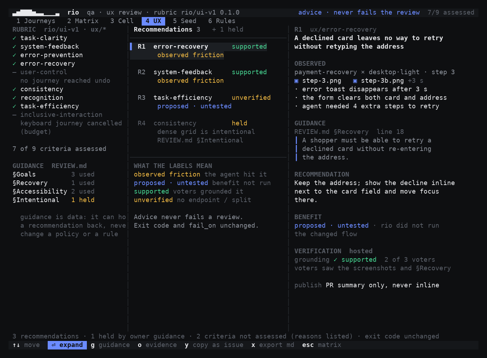

# Inspect QA evidence and UX recommendations

## Outcome

Understand what was observed in each browser cell and manage retained artifacts.

## Prerequisites

A QA run with synthetic data and appropriate masking. Hosted evidence operations need endpoint/API token. Artifacts can still contain application data, so treat them as sensitive as the project.

## Steps

Open a journey's matrix cell in the TUI, then inspect step screenshots, DOM and traces alongside base/head outcomes and guidance citations. At narrow widths, `v` swaps details and screenshot. Export the report for durable review.

Distinguish deterministic UI probes, functional failures and model UX recommendations. A recommendation explains observed friction and a proposed improvement; the improvement's benefit is not proven by the current run. A passing journey may still have recommendations, which cannot fail review policy. Without an endpoint, judged observations/recommendations remain explicitly unverified.

## Expected results

Artifacts are associated with a journey/viewport/color scheme and version. Reports retain missing/failed/cancelled cells rather than treating them as passes. Downloaded hosted screenshots are cached in the run's `qa-images` for seven days, up to 200 MB. Evidence citations allow the reviewer to connect a claim to the actual UI.

## Troubleshooting

For a failed cell, inspect app/seed readiness first, then blocked-host diagnostics and the failing step. A harness/model timeout means incomplete evidence. Terminal image capability can limit inline previews; textual evidence and exported artifacts remain available.

To delete hosted evidence deliberately, run `rio qa evidence prune --review REVIEW_ID` with the real review ID. This removes objects and revokes download links; retain evidence needed by ongoing review first. Removing a local download does not delete hosted objects, and uninstall does not clean all repository caches.

## Next steps

[Fix journey coverage](qa-journeys.md), [tune limits](budgets.md), or [manage cache privacy](cache.md).

## Screenshots

Inspect the failing step and available artifacts. Demo data; captured from the current CLI/TUI renderer. [Text transcript](../assets/qa-q3-cell-detail.txt).

Separate observed friction from a proposed benefit. Demo data; captured from the current CLI/TUI renderer. [Text transcript](../assets/qa-q4-ux-recommendations.txt).

<!-- commands:start -->

## Command reference

### `rio qa evidence`

| Argument | Meaning | Default / choices |
| --- | --- | --- |
| `--help` | Show command syntax and supported options. | `—` |
### `rio qa evidence prune`

| Argument | Meaning | Default / choices |
| --- | --- | --- |
| `--review` | Review ID whose hosted QA evidence will be deleted. | `—` |
| `--help` | Show command syntax and supported options. | `—` |

<!-- commands:end -->
