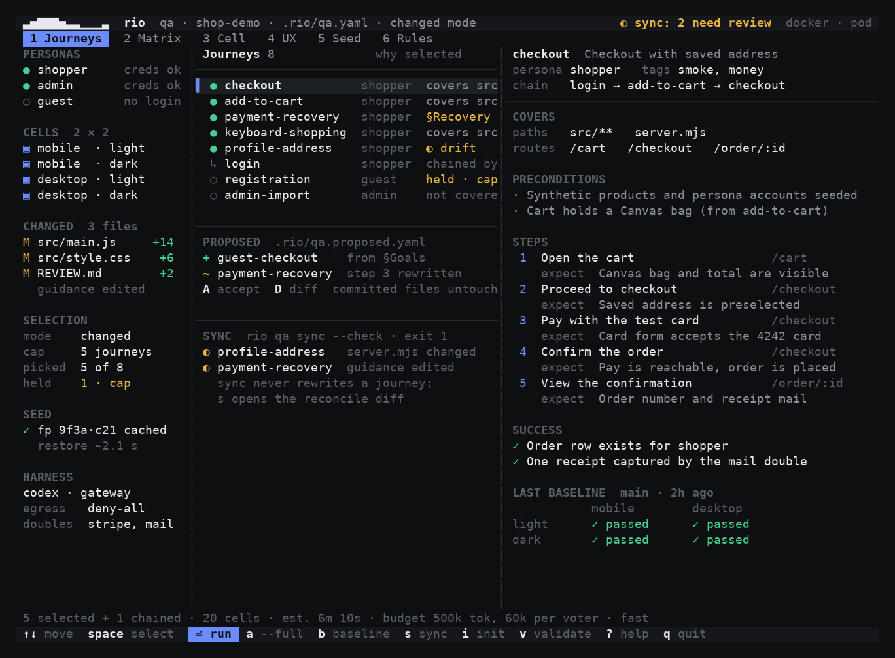
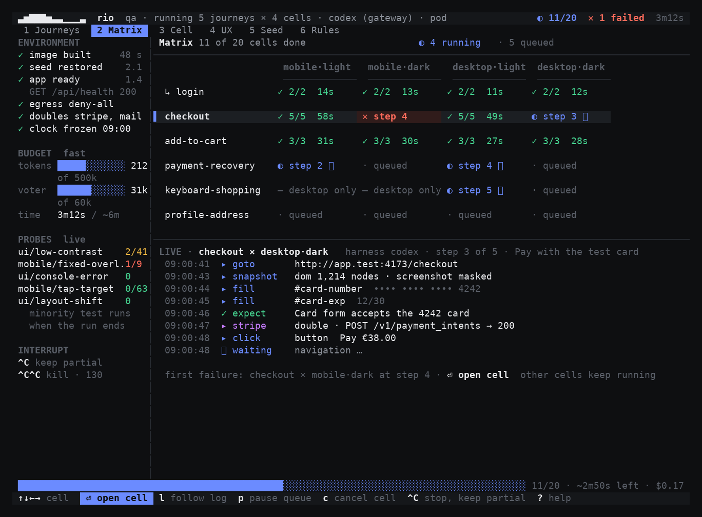

# Your first browser QA run

## Outcome

Exercise real user journeys in isolated browsers and inspect functional, accessibility and UX evidence.

## Prerequisites

A Git application repository, Linux Docker host with firewall control, paired QA image, a launch contract, synthetic seed/fixtures and model authentication. The authoring harness supports `codex` or `pi`; use the supported local subscription or host keychain route. Do not copy production credentials/data into fixtures. Local judgments remain unverified without an endpoint.

## Steps

Build the paired image from the Rio source checkout:

```sh
docker build -f worker/Dockerfile.qa -t rio-qa:0.1.0 .
```

In your application, define `.rio/qa.yaml`. This example illustrates an image-based Node app; adapt its port/start command/Dockerfile to your app:

```yaml
version: 1
app:
  packaging: image
  dockerfile: Dockerfile.qa
  start: npm run build && node server.mjs
  url: http://app.test:4173
  ready: {path: /api/health, status: 200}
personas:
  - name: guest
    description: A visitor without an account
browser:
  viewports: [mobile, desktop]
  color_schemes: [light, dark]
```

Use the complete [sample application](../../../tests/fixtures/qa-sample/README.md) to learn seed/service fixtures. Write `REVIEW.md` with user goals and intentional design choices. Then, from the application repository:

```sh
rio qa validate
rio qa seed build
rio qa init
rio qa list
rio qa --full
```

Init can propose missing setup; review `.rio/qa.proposed.yaml` before `rio qa init --accept-contract`. Existing journeys get proposals; `--force` allows validated journey replacement but does not accept a launch contract or overwrite arbitrary setup definitions. Concurrent edits are protected.

## Expected results

A matrix shows journey × viewport × color scheme. Default `rio qa` selects changed coverage; `--full` selects all; repeated `--journey NAME` selects named journeys and prerequisites. `--baseline` compares base/head; `--cell mobile/dark` narrows to a valid cell. `--staged`/`--base REF` select source as in review. The default profile is `rio/qa`; custom profiles must enable QA.

`rio qa show` prints the resolved environment, `show NAME` a journey, `rules` the rubric. Use `--format json` for automation. UX recommendations can appear on passing journeys and cannot fail the review; observed friction and predicted benefit remain distinct.

## Troubleshooting

Validate before startup. Check image availability, app readiness and model authentication. Use `app.test`, not bare `app`, for container HTTP to avoid Chromium HSTS upgrades. Compose-only or unknown topology can require a reviewed `Dockerfile.qa` or proposed contract. Blocked dependencies are reported; they do not justify assuming a journey passed.

## Next steps

[Author journeys](qa-journeys.md), [prepare seeds/fixtures](qa-seeds.md), and [inspect evidence](qa-evidence.md).


## Screenshots



Select journeys and inspect their dependencies. Demo data · actual Rio renderer · [Text transcript](../assets/qa-q1-journeys.txt).



Follow outcomes by viewport and color scheme. Demo data · actual Rio renderer · [Text transcript](../assets/qa-q2-matrix-live.txt).

<!-- commands:start -->

<details>
<summary>All command options</summary>

## Command reference

### `rio qa`

| Argument | Meaning | Default / choices |
| --- | --- | --- |
| `--staged` | Select only the index against HEAD; conflicts with --base. | `false` |
| `--base` | Compare committed HEAD against the merge base with this ref. | `—` |
| `--profile` | Select a named profile or explicit YAML path. | `—` |
| `--format` | Choose the output format; supported values are listed. | `terminal, json, md, sarif` |
| `--no-tui` | Use streaming output or terminal prompts instead of the TUI. | `false` |
| `--no-color` | Disable ANSI color. | `false` |
| `--ascii` | Use ASCII terminal glyphs (also RIO_ASCII=1). | `false` |
| `--publish` | Request publication according to hosted policy; remote side effects. | `false` |
| `--full` | Run all QA journeys; conflicts with explicit --journey. | `false` |
| `--journey` | Select a named QA journey and its prerequisites; repeatable. | `—` |
| `--baseline` | Run QA against base as well as head. | `false` |
| `--harness` | Select the QA browser authoring/execution driver. | `codex, pi` |
| `--cell` | Select one viewport/color-scheme QA cell. | `—` |
| `--help` | Show command syntax and supported options. | `—` |
### `rio qa init`

| Argument | Meaning | Default / choices |
| --- | --- | --- |
| `--force` | Replace existing committed journeys after validating the generated batch; does not accept a launch contract. | `false` |
| `--accept-contract` | Accept the reviewed proposed QA launch contract. | `false` |
| `--help` | Show command syntax and supported options. | `—` |
### `rio qa validate`

| Argument | Meaning | Default / choices |
| --- | --- | --- |
| `--help` | Show command syntax and supported options. | `—` |
### `rio qa list`

| Argument | Meaning | Default / choices |
| --- | --- | --- |
| `--help` | Show command syntax and supported options. | `—` |
### `rio qa show`

| Argument | Meaning | Default / choices |
| --- | --- | --- |
| `<name>` | Journey name to inspect; omit it to show the resolved QA environment. | `—` |
| `--help` | Show command syntax and supported options. | `—` |
### `rio qa rules`

| Argument | Meaning | Default / choices |
| --- | --- | --- |
| `--help` | Show command syntax and supported options. | `—` |

</details>

<!-- commands:end -->
