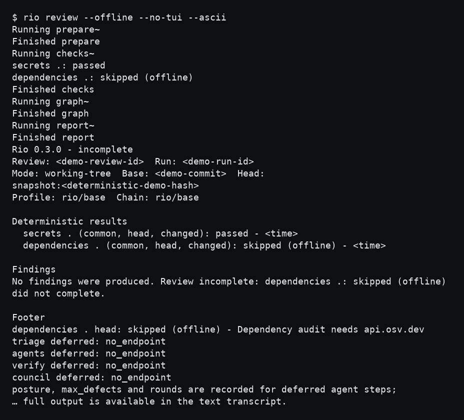

# Your first local review

## Outcome

Review a small change, understand what Rio checked, and decide what to fix. A Cloudflare account or model key is not required for local checks.

## Prerequisites

[Install Rio](installation.md), open a Git working tree, and install the project's own dependencies and tools. TypeScript uses tsc/ESLint/Vitest or Jest; Python uses Pyright or mypy/Ruff/pytest/coverage.py; Rust uses Cargo and optional Clippy/rustfmt/llvm-cov. Rio does not install these for you.

## Steps

1. Make a small, intentional source edit in your project.
2. Run `rio doctor` and address blocking readiness problems.
3. Run `rio review --no-tui` for streaming output, or `rio review` for the [interactive UI](tui.md).
4. Read check outcomes before interpreting findings. Fix a confirmed problem and rerun.

Choose a local selection or a hosted PR review:

| Command | What it reviews |
| --- | --- |
| `rio review` | Working tree, staged changes and untracked nonignored files against HEAD |
| `rio review --staged` | Index against HEAD; excludes unstaged edits |
| `rio review --base origin/main` | Committed HEAD against the merge base; excludes local edits |
| `rio review --pr 123` | Review a GitHub PR through your [endpoint and installed App](github.md) |

For an agent or CI, use `rio review --format json > report.json`. `--format md` produces Markdown and `--format sarif` produces code-scanning output. Progress goes to stderr. `--profile NAME_OR_PATH` selects a [profile](profiles.md).

Choose your changes before running. Demo data · [Text transcript](../assets/review-00-start.txt).

## Expected results

You see the selected source, profile and run identity, checks that passed/found issues/failed/skipped, and findings with evidence. Without an endpoint, model steps are explicitly deferred. A clean working tree produces “No changes to review.” Zero findings with skipped or failed checks is not proof that the whole review passed.

## Troubleshooting

`dependency_mismatch`: synchronize installed dependencies with the selected lockfile. Missing tool: install the project's pinned tool. `--offline` skips Rio network activity, including online auditing, but tools/tests are not network-isolated. Use external isolation if needed.

Conflicted indexes are refused for working-tree/staged selections. Branch comparisons need sufficient merge-base history; deepen shallow clones. Hydrate missing partial-clone objects first: Rio does not fetch them. Bare repositories are refused; submodules remain gitlinks and LFS files remain pointers. Linked worktrees and sparse checkouts are supported with these limits.

First Ctrl-C preserves a partial report; a second kills remaining processes and exits 130. See [results and exit codes](results.md) before treating a nonzero exit as a crash.

## Next steps

[Read results](results.md), [adjust checks](profiles.md), or [enable hosted AI review](hosting.md).

## Screenshots

A real offline review of a synthetic documentation change; model steps are deferred. Demo data · actual Rio renderer · [Text transcript](../assets/cli-review.txt).

<!-- commands:start -->

All command options

## Command reference

### `rio review`

| Argument | Meaning | Default / choices |
| --- | --- | --- |
| `--staged` | Select only the index against HEAD; conflicts with --base. | `false` |
| `--base` | Compare committed HEAD against the merge base with this ref. | `—` |
| `--profile` | Select a named profile or explicit YAML path. | `—` |
| `--format` | Choose the output format; supported values are listed. | `terminal, json, md, sarif` |
| `--offline` | Disable Rio network calls; subprocesses are not network-isolated. | `false` |
| `--no-color` | Disable ANSI color. | `false` |
| `--ascii` | Use ASCII terminal glyphs (also RIO_ASCII=1). | `false` |
| `--no-tui` | Use streaming output or terminal prompts instead of the TUI. | `false` |
| `--show-pre-existing` | Include baseline/pre-existing findings in output. | `false` |
| `--show-remembered` | List remembered dismissals separately without changing exit policy. | `false` |
| `--pr` | GitHub pull request number; requires an endpoint and installed GitHub App. | `—` |
| `--deep` | Use the deep preset; conflicts with --preset. | `false` |
| `--preset` | Select review depth; requires an online endpoint. | `quick, standard, deep` |
| `--fork` | Mark this local hosted submission as fork-related; endpoint validates PR metadata. | `false` |
| `--nightly` | Mark a nightly evaluation run for council triggers. | `false` |
| `--publish` | Request publication according to hosted policy; remote side effects. | `false` |
| `--since-last` | Continue the current branch lineage at the endpoint. | `false` |
| `--reset-lineage` | Start a new branch lineage generation; requires --since-last. | `false` |
| `--help` | Show command syntax and supported options. | `—` |

<!-- commands:end -->
