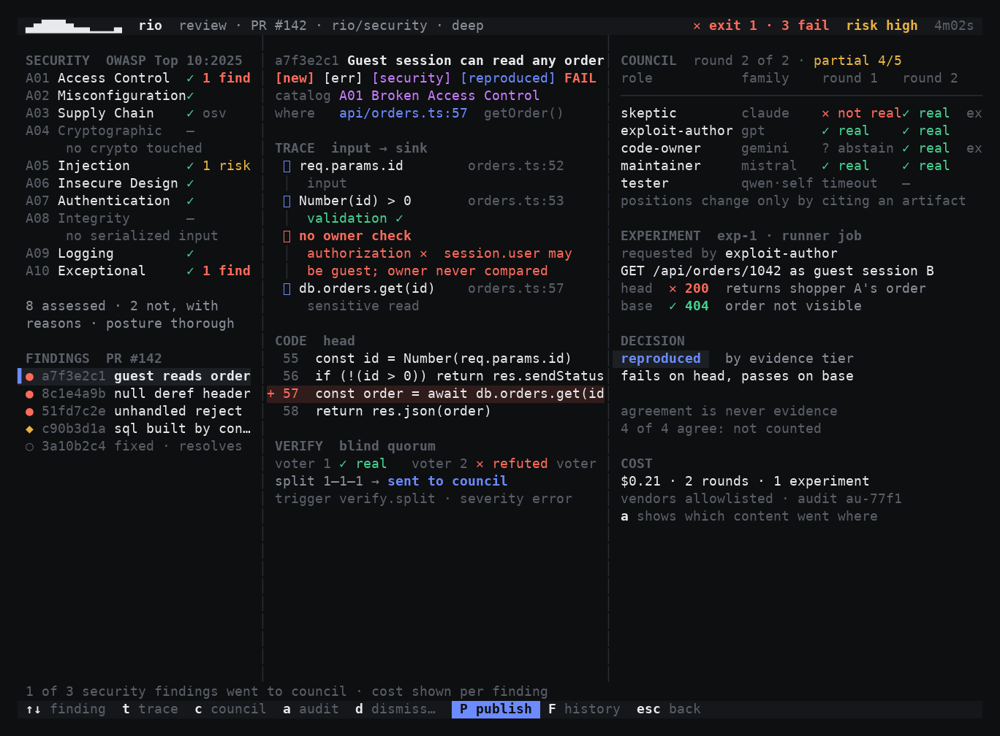

# Review security with evidence

## Outcome

Assess relevant security controls and understand which catalog items were actually examined.

## Prerequisites

Hosted AI setup for the security agent; local secret scanning is available separately. The security profile also enables council placeholders, which need vendor opt-in to run. Evidence may reach configured providers.

## Steps

```sh
rio profile show rio/security
rio review --profile rio/security
```

The `rio/security` step is disabled in `rio/base`. Its built-in security profile uses thorough posture and `asvs-5.0`; the step also supports `owasp-top10-2025`. These are catalog IDs, not arbitrary file paths. Its security agent is declared with `models: [default, second]`: a child profile that defines a `second` model alias gets the change reviewed for security under both, and what both raise is verified once; without it, one review runs under `default`. Pick two vendors for `default` and `second`. When customizing a profile's steps, preserve every desired step and verification dependency.

Read the security section's assessed, unassessed and not-applicable catalog items. A trace explains source, intermediate steps and sink; missing protection is not automatically a reproduced exploit. Severity and evidence answer different questions.

## Expected results

Security has its own evidence/presentation pool. `with.fail_on` on the security step defaults to plausible-or-stronger new/worsened security findings. Either that policy or general failure policy can fail a finding before presentation caps. Plausible entries remain risks for human judgment; a scan is not certification.

Owner guidance is considered with evidence, but cannot enable tools or bypass budgets/policy. Unassessed items explain budget/evidence/tool limitations and must not be presented as a passed security review. Fork PR security analysis is static-only.

## Troubleshooting

Check profile enablement, model route, catalog ID and verification dependencies. Missing vendors affect council separately from the security agent. Pending acceptance gates remain pending even when implementation/tests exist. Do not replace unassessed controls with claims of coverage.

## Next steps

[Understand council](council.md), [adjust policy](profiles.md), or [inspect results](results.md).

## Screenshots



Read the trace and council evidence together. Demo data · actual Rio renderer · [Text transcript](../assets/team-p1-security-council.txt).

