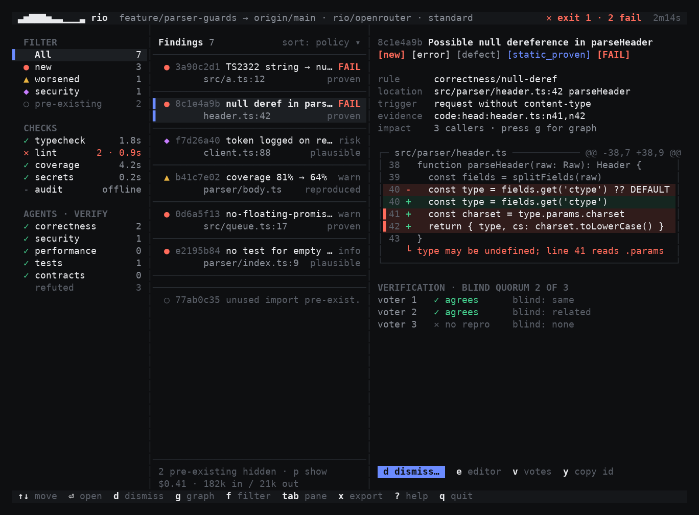

# Rio — code review in your terminal

Review your code changes **before they merge**, right where you work. Rio checks uncommitted edits, staged files, branches, and GitHub pull requests. It brings your project's type checks, lint, tests, and security checks into one review, so you can see what ran, what failed, and which lines need attention.

**Start locally with `rio review`.** You don't need a cloud account or an API key for local checks. Add AI review when you want model reviewers and independent verification.



*A branch review with hosted AI enabled: inspect a finding, its code, and the evidence behind it. Demo data · actual Rio renderer · [Text transcript](../assets/review-02-findings.txt).*

## Start with a local review

[Install Rio](installation.md), open a Git project, and install that project's dependencies. Then run:

```sh
rio doctor     # Check which tools are ready
rio review     # Review your local changes
```

Rio opens the interactive terminal UI when the terminal supports it. Use `rio review --no-tui` for plain output, or `rio review --format json` for scripts and agents. Markdown (`--format md`) and SARIF (`--format sarif`) exports are also available.

Read the checks as well as the findings: missing tools or skipped checks mean the review is incomplete. [Walk through your first review →](review.md)

## Choose what to review

| Your changes | Command | What you need |
| --- | --- | --- |
| Uncommitted edits, including staged and new nonignored files | `rio review` | Git project and its tools |
| Only staged files | `rio review --staged` | Changes added to the index |
| Commits on your branch since it split from `origin/main` | `rio review --base origin/main` | The base ref and its history locally |
| A GitHub pull request | `rio review --pr 123` | [Endpoint and GitHub App setup](github.md) |
| User journeys through a web app | `rio qa` | [Browser QA setup](qa.md) |


*Choose the changes and profile before starting. Demo data; displayed versions are fixture values · [Text transcript](../assets/review-00-start.txt).*

## Three ways to use Rio

| Workflow | What it adds | Setup |
| --- | --- | --- |
| **Local code review** | Type checking, lint, changed-line test coverage, secret scanning, dependency audit, and an impact graph | Rio and your project's tools. TypeScript, Python, and Rust have built-in adapters. Dependency auditing uses network access. [First review](review.md) |
| **AI review** | Model reviewers propose issues; independent verifiers assess the evidence. Add PR reviews and team collaboration. | An endpoint in your own Cloudflare account (or your team's), a runner, and model credentials. [Connect or deploy](hosting.md) |
| **Browser QA** | Browser journeys across screen sizes and themes, with functional, accessibility, and UX evidence | A Linux Docker host with firewall control, a QA image, model access, and app/fixture contracts. [Set up QA](qa.md) |

Without an endpoint, AI review steps are marked **deferred**; available local checks still run. Browser QA has its own model/runtime requirements. `--offline` stops Rio's own network requests; it does not isolate project tests or tools from the network. [Data and privacy](cache.md)

## Find your next step

- **Understand a result:** [Findings and exit codes](results.md) · [Terminal controls](tui.md)
- **Tune your review:** [Profiles and checks](profiles.md) · [Model budgets](budgets.md)
- **Work with your team:** [Pull requests](github.md) · [CI and code scanning](ci.md)
- **Get help:** [Troubleshooting](troubleshooting.md) · [All guides](guides.md) · [Command and settings reference](reference.md)
- **Use a coding agent:** `rio docs` provides compact, offline help matched to the installed binary. [Agent documentation](docs.md)

## Availability

Rio targets Linux, macOS, and Windows on x64/arm64. Check the installation guide for available releases or a source build. These pages describe the source version in the footer; a downloadable release may differ.

Rio is pre-1.0, and its recorded quality evaluation is not yet complete. Treat findings as help for your review, and inspect the evidence. [Evaluation details](evaluation.md)
