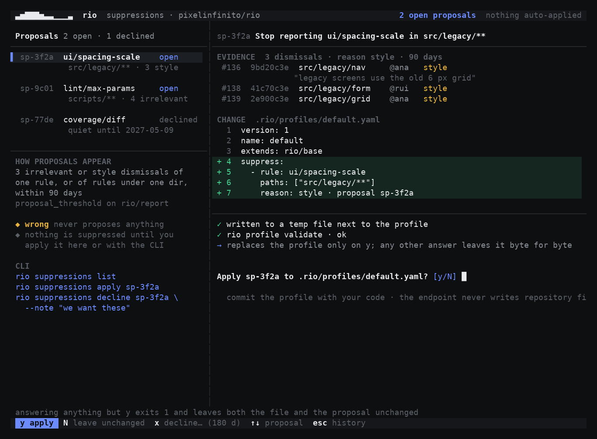

# Apply or decline suppression proposals

## Outcome

Turn repeated irrelevant/style feedback into an explicit, reviewable policy change.

## Prerequisites

Endpoint/API token and repository. Applying writes `.rio/profiles/default.yaml`; declining changes endpoint proposal state. Inspect the supporting evidence first.

## Steps

```sh
rio suppressions list --format json
rio suppressions apply PROPOSAL_ID
rio suppressions decline PROPOSAL_ID --note "keep reporting this rule"
```

Choose apply **or** decline for an actual proposal ID. List accepts status `proposed`, `applied` or `declined`. By default, three matching dismissals in 90 days can produce a rule/directory proposal. A proposal alone suppresses nothing.

Apply prints the entry/evidence and asks for confirmation. Only `y` proceeds; other answers leave the file/proposal unchanged and exit 1. `--yes` deliberately bypasses this prompt. If no default profile exists, Rio creates one extending `rio/base`. It writes and validates a temporary sibling before replacing the profile, so validation/write failure preserves the original bytes. Commit the policy change with your code.

## Expected results

Applied entries appear under `suppress`, and the endpoint marks the proposal applied. Declining prevents the same entry from being proposed again for 180 days. The TUI offers proposals through `S` and requires confirmation for application.

## Troubleshooting

Proposal IDs differ from finding IDs. Usage/configuration/validation failures generally exit 2; endpoint/repository/persistence failures exit 3. If local application succeeds but marking the proposal fails remotely, inspect both before retrying: remote failure does not prove the local file is unchanged. Suppression is a policy decision, not evidence that a defect was fixed.

## Next steps

[Validate the resulting profile](profiles.md) and [review finding history](feedback.md).


## Screenshots



Inspect proposal evidence before changing the profile. Demo data; captured from the current CLI/TUI renderer. [Text transcript](../assets/team-p4-suppression-proposals.txt).

<!-- commands:start -->

## Command reference

### `rio suppressions`

| Argument | Meaning | Default / choices |
| --- | --- | --- |
| `--help` | Show command syntax and supported options. | `—` |
### `rio suppressions list`

| Argument | Meaning | Default / choices |
| --- | --- | --- |
| `--status` | Filter lifecycle status using the listed accepted values. | `proposed, applied, declined` |
| `--format` | Choose the output format; supported values are listed. | `terminal, json` |
| `--help` | Show command syntax and supported options. | `—` |
### `rio suppressions apply`

| Argument | Meaning | Default / choices |
| --- | --- | --- |
| `<id>` | Finding prefix (at least 8 characters) or proposal ID, as appropriate. | `—` |
| `--yes` | Apply a suppression proposal without the confirmation prompt. | `false` |
| `--help` | Show command syntax and supported options. | `—` |
### `rio suppressions decline`

| Argument | Meaning | Default / choices |
| --- | --- | --- |
| `<id>` | Finding prefix (at least 8 characters) or proposal ID, as appropriate. | `—` |
| `--note` | Attach an explanation to feedback or proposal rejection. | `—` |
| `--help` | Show command syntax and supported options. | `—` |

<!-- commands:end -->
