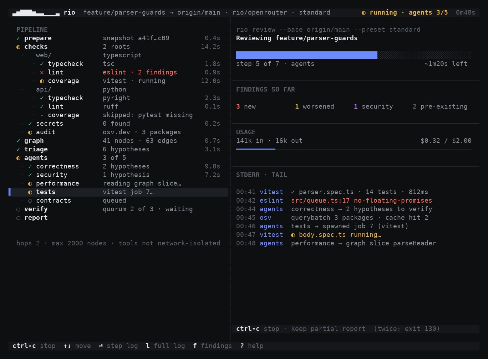
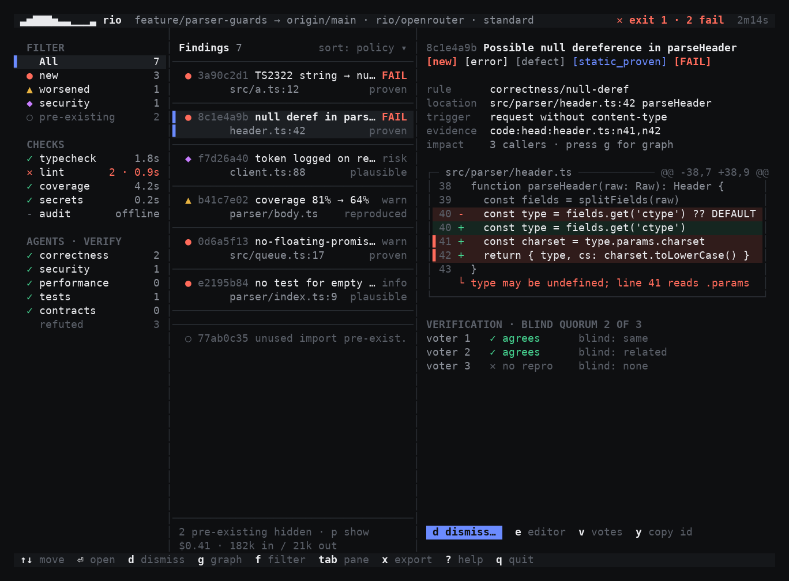
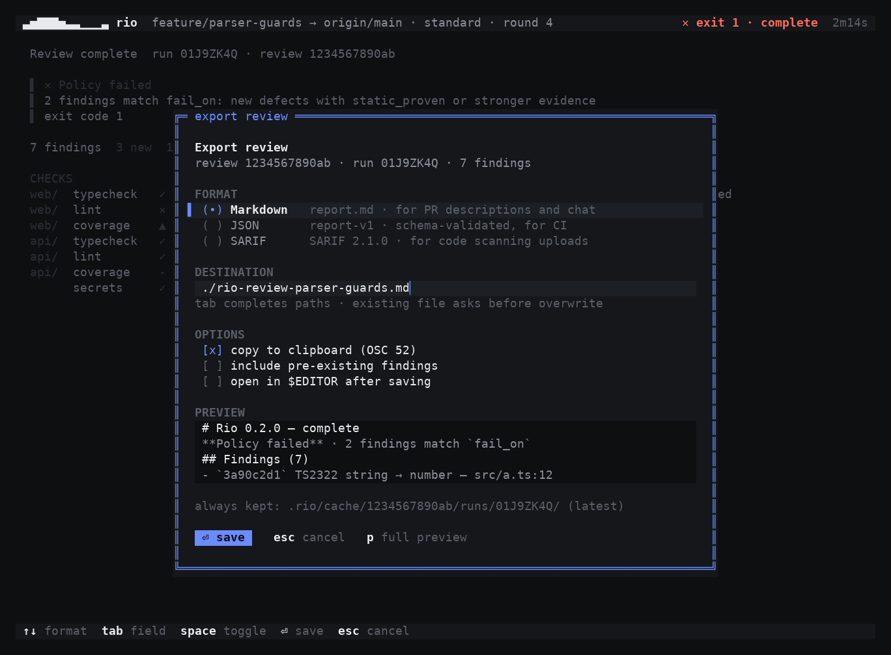

# Use the interactive terminal

## Outcome

Move from selection to findings, evidence and export without remembering every CLI option.

## Prerequisites

An interactive terminal with stdin/stdout attached, at least 80×24 cells, no explicit `--format`, and `CI` unset. Review, QA and setup have interactive screens. The UI itself is English; this Wiki translates its explanations.

## Steps

Run `rio review`. Select the source/profile/depth, follow live checks, then open a finding to inspect its hunk and verification. Use export to save the report.

| Key | Action |
| --- | --- |
| `?` / `:` | Help and view map / command palette |
| Tab | Next pane |
| Arrows or `j`/`k` | Move |
| Enter / Esc | Open / back |
| `/` | Search |
| `q` | Quit; offers to save an unsaved report |
| `F` / `S` / `P` | Finding history / suppression proposals / PR publish preview |

Keys depend on the current view; the help/palette shows valid actions. Security detail can open trace and council evidence. Publishing a PR and writing a suppression profile require explicit confirmation.

For QA, open a matrix cell to inspect steps/evidence. Local `p` pauses the queue after the current cell; the budget clock keeps counting. `c` cancels the focused cell. Hosted queues refuse these controls. A completed cell's `r` reruns that cell, while export/exit retain the original run. At narrow widths, `v` switches between details and screenshot.

## Expected results

Leaving the UI restores the terminal and prints a summary with the review exit code. First Ctrl-C cancels running work but keeps partial results; the second exits 130 after stopping processes.

## Troubleshooting

Use `rio review --no-tui` or `RIO_TUI=0` for streaming. Use `--ascii`/`RIO_ASCII=1` for terminals with problematic glyph widths. `NO_COLOR` removes color while preserving state labels. Enlarge the terminal if it is smaller than 80×24. Setup failure can be resumed with the retry action or a later `rio deploy`.

## Next steps

[Understand reports](results.md), [inspect team history](feedback.md), or [run browser QA](qa.md).

## Screenshots

Choose the change set and profile. Demo data; captured from the current CLI/TUI renderer. [Text transcript](../assets/review-00-start.txt).

Follow live checks and model progress. Demo data; captured from the current CLI/TUI renderer. [Text transcript](../assets/review-01-live-review.txt).

Connect each finding to its hunk and evidence. Demo data; captured from the current CLI/TUI renderer. [Text transcript](../assets/review-02-findings.txt).

Choose a report export format. Demo data; captured from the current CLI/TUI renderer. [Text transcript](../assets/review-05-summary-export.txt).

