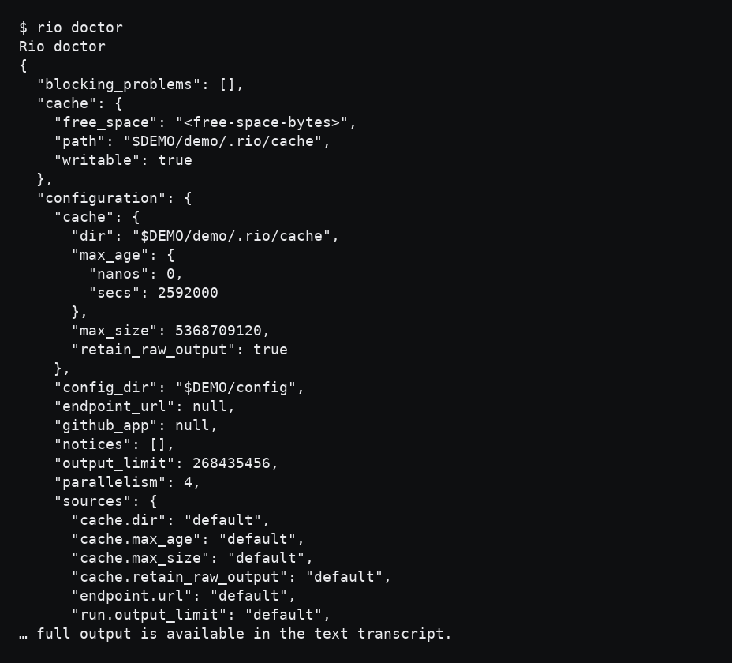

# Diagnostique ferramentas e preparação

## Objetivo

Descobrir por que uma revisão ignoraria verificações ou falharia antes de executar toda a análise.

## Pré-requisitos

Execute dentro do projeto e instale suas dependências primeiro. O diagnóstico compartilha o planejador da revisão e pode consultar ferramentas, cache e um endpoint configurado.

## Passos

```sh
rio doctor
rio doctor --all-roots
rio doctor --base origin/main --format json
```

Por padrão, são inspecionadas as raízes afetadas pelas alterações locais. Sem alterações, nenhuma raiz é sondada. `--all-roots` inclui projetos fora do diff; `--staged` e `--base REF` usam as mesmas seleções da revisão. O JSON mostra valores e suas origens, raízes, ferramentas, lockfiles, compatibilidade de dependências, disponibilidade da base, cache e preparação.

## Resultados esperados

Encontrar uma ferramenta não garante que ela possa executar nesse snapshot: as dependências instaladas podem divergir do lockfile. Saída 0 significa ausência de impedimento de configuração/perfil/repositório/cache; ferramentas ausentes são avisos. Saída 1 indica um impedimento. Os códigos do diagnóstico diferem dos códigos de achados e análise incompleta da revisão.

## Solução de problemas

| Sintoma | Como resolver |
| --- | --- |
| Ferramenta ausente | Instale a versão do verificador/linter/cobertura definida pelo projeto |
| `dependency_mismatch` | Recrie ou sincronize a instalação com o lockfile selecionado |
| Compatibilidade desconhecida | Examine os metadados; use `trust_installed_dependencies` apenas com justificativa |
| Cache sem permissão / disco cheio | Confira caminho e permissões; libere espaço ou altere a configuração pessoal |
| Perfil inválido | Execute `rio profile validate` e corrija os caminhos YAML indicados |
| Instalação GitHub ausente | Instale o App no repositório indicado pelo origin |

Confiar nas dependências não supera uma divergência conhecida. Diagnósticos confiados permanecem sem classificação e não recebem a comparação normal com a base. `rio doctor --rotate` é uma operação de alteração separada: rotaciona o segredo do webhook do GitHub App com tratamento de reversão. Não o use para inspeção comum.

## Próximos passos

[Corrija a configuração](configuration.md) e [execute a revisão](review.md).


## Capturas de tela



Leia avisos de preparação antes de interpretar a revisão. Dados demonstrativos · renderizador real do Rio · [Transcrição textual](../assets/cli-doctor.txt).

<!-- commands:start -->

<details>
<summary>Todas as opções dos comandos</summary>

## Referência de comandos

### `rio doctor`

| Argumento | Significado | Padrão / valores |
| --- | --- | --- |
| `--rotate` | Rotaciona o segredo do webhook do GitHub App; altera dados. | `false` |
| `--all-roots` | Inspeciona todas as raízes, inclusive não alteradas. | `false` |
| `--staged` | Seleciona somente alterações preparadas (staged) contra HEAD; conflita com --base. | `false` |
| `--base` | Compara os commits do HEAD com a base comum desta referência. | `—` |
| `--format` | Escolhe formato de saída; valores suportados são listados. | `terminal, json` |
| `--help` | Mostra sintaxe e opções do comando. | `—` |

</details>

<!-- commands:end -->
