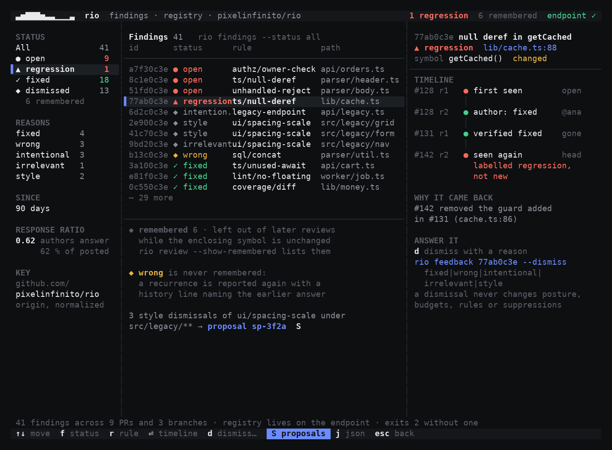

# Responda aos achados e acompanhe o histórico

## Objetivo

Explicar o destino de um achado e evitar revisões repetitivas sem perder evidências de regressões.

## Pré-requisitos

Endpoint online, token e repositório. Linhagens de branch exigem uma branch ativa, não HEAD destacado. Feedback altera o estado no endpoint; não muda regras do perfil nem suprime código automaticamente.

## Passos

```sh
rio review --since-last
rio findings --status dismissed --format json
rio feedback 8c1e4a9b --dismiss intentional --note "comportamento documentado"
```

Substitua o ID de exemplo por um real: pelo menos oito caracteres que identifiquem um único achado. Motivos aceitos: `fixed`, `wrong`, `intentional`, `irrelevant`, `style`. Use `fixed` após corrigir, `wrong` quando o diagnóstico estiver incorreto e explique comportamentos intencionais na nota. O autor vem de `git config user.email`, quando disponível.

`--since-last` continua a linhagem da branch, controlada pelo endpoint. `--reset-lineage` exige essa opção e inicia deliberadamente uma nova geração. Perder o cache local não reinicia rodadas. URL normalizada do origin e branch identificam a linhagem, preservada após rebase. Depois do limite de rodadas, itens não resolvidos são resumidos para reconsideração; relatório e política continuam considerando os achados.

## Resultados esperados

Dispensas intentional/irrelevant/style são lembradas enquanto o símbolo envolvido não mudar. Wrong não é lembrado; a recorrência cita a resposta anterior. Um achado corrigido que volta é regressão. `--show-remembered` mostra entradas lembradas sem alterar a política.

`rio findings` filtra por estado, regra ou data RFC3339 em `--since`. `F` abre o histórico na TUI. Feedback retorna 0 ao registrar, 2 para entradas inválidas ou endpoint/token ausente e 3 para IDs rejeitados/ausentes/ambíguos. Ambiguidade retorna candidatos.

## Solução de problemas

Amplie um ID curto ou ambíguo. Erro no endpoint não justifica mudar a política local. No GitHub, `/rio dismiss ID MOTIVO [nota]` exige colaborador/mantenedor autorizado e achado da linhagem daquele PR.

## Próximos passos

[Examine propostas de supressão](suppressions.md) quando repetições irrelevantes/de estilo indicarem necessidade de ajuste da política.


## Capturas de tela



Inspecione respostas anteriores e ciclo do achado. Dados demonstrativos · renderizador real do Rio · [Transcrição textual](../assets/team-p3-finding-history.txt).

<!-- commands:start -->

<details>
<summary>Todas as opções dos comandos</summary>

## Referência de comandos

### `rio feedback`

| Argumento | Significado | Padrão / valores |
| --- | --- | --- |
| `<id>` | Prefixo inequívoco do ID do achado, com no mínimo 8 caracteres. | `—` |
| `--dismiss` | Registra resposta fixed, wrong, intentional, irrelevant ou style. | `—` |
| `--note` | Explicação a anexar à resposta sobre o achado. | `—` |
| `--help` | Mostra sintaxe e opções do comando. | `—` |
### `rio findings`

| Argumento | Significado | Padrão / valores |
| --- | --- | --- |
| `--status` | Filtra estado pelos valores aceitos listados. | `open, fixed, dismissed` |
| `--rule` | Filtra achados pelo ID da regra. | `—` |
| `--since` | Filtra atualizações nesta data RFC3339 ou posteriores. | `—` |
| `--format` | Escolhe formato de saída; valores suportados são listados. | `terminal, json` |
| `--help` | Mostra sintaxe e opções do comando. | `—` |

</details>

<!-- commands:end -->
