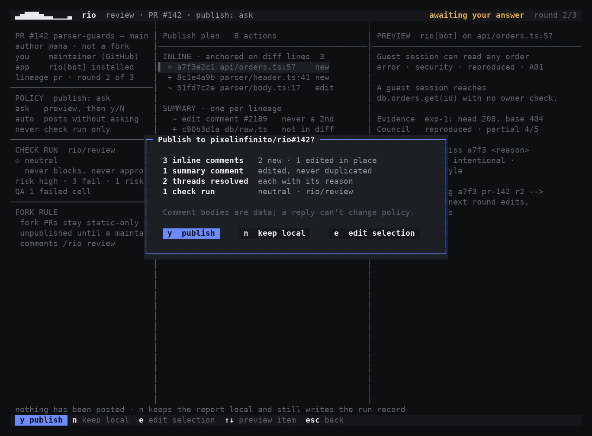

# Revise pull requests com a equipe

**Revisões automáticas:** após a configuração, o GitHub App revisa eventos elegíveis de abertura/push de PRs. **Sob demanda pelo terminal:** execute `rio review --pr 123` para revisar um PR específico. Ambos usam o endpoint e a política de publicação do repositório.

## Objetivo

Executar revisões hospedadas de PRs e publicar achados conforme uma política explícita do repositório.

## Pré-requisitos

Endpoint configurado, GitHub App instalado no repositório do origin, rotas de modelos e runner adequado. PRs de forks exigem runner próprio. A publicação escreve comentários e verificações no GitHub.

## Passos

1. Execute `rio init --github-app` após/junto da implantação; use `--github-org ORG` para organização.
2. Conclua o registro por manifesto do GitHub e instale o App nos repositórios desejados.
3. Execute `rio doctor` para verificar protocolo e instalação.
4. Versione o perfil padrão na branch base, incluindo modelos e `publish: ask`, `auto` ou `never`.
5. Execute `rio review --pr 123` com o número real do PR. Com `ask`, examine e confirme a prévia ou forneça `--publish` deliberadamente na automação.

A política vem da base comum do PR: a alteração revisada não pode conceder a si mesma permissão de publicação. `rio/base` usa `publish: never` e não define modelos. Eventos de abertura/push disparam revisão; mantenedores autorizados podem comentar `/rio review` para solicitar revisão e reiniciar a linhagem.

A preparação do PR (download dos dois commits, snapshot e grafo) pode levar 15 minutos antes de a revisão começar. Um repositório grande permite mais nesse mesmo perfil da base comum com `budget: { prepare: 30m }` (de 1 a 60 minutos).

## Resultados esperados

Auto publica achados elegíveis nas linhas, resumo e uma verificação neutra `rio/review`. Ask publica a verificação e aguarda autorização explícita. Never não publica. Forks também exigem ação de mantenedor. Rodadas seguintes atualizam comentários identificados e resolvem discussões de achados corrigidos/dispensados.

O App usa leitura de conteúdo, escrita de PRs/verificações e leitura de metadados; lê membros da organização quando necessário. Um token de escrita de conteúdo restrito é usado apenas em cada mutação GraphQL para resolver/reabrir uma discussão, sendo revogado em seguida. Tokens não são entregues ao contêiner de análise. Veja [CI](ci.md) para bloquear por política: verificações do App são neutras.

## Solução de problemas

Inspecione `report.publication` para motivo/contagens/URLs. Saída 5 significa falha de publicação após revisão que passaria; confira comentários existentes antes de repetir. Dependências ausentes em snapshots hospedados podem impedir verificações; execução hospedada não as instala.

`rio doctor --rotate` rotaciona o segredo do webhook. `rio init --replace-private-key ARQUIVO.pem` instala nova chave; verifique antes de excluir a antiga no GitHub. Avisos de instalação incluem URL de instalação. Divergências de protocolo exigem atualização pareada de CLI/Worker.

## Próximos passos

[Responda aos achados](feedback.md), [gerencie supressões](suppressions.md) ou [integre CI](ci.md).

## Capturas de tela

Examine o que será publicado antes de confirmar. Dados demonstrativos · renderizador real do Rio · [Transcrição textual](../assets/team-p2-publish-preview.txt).

