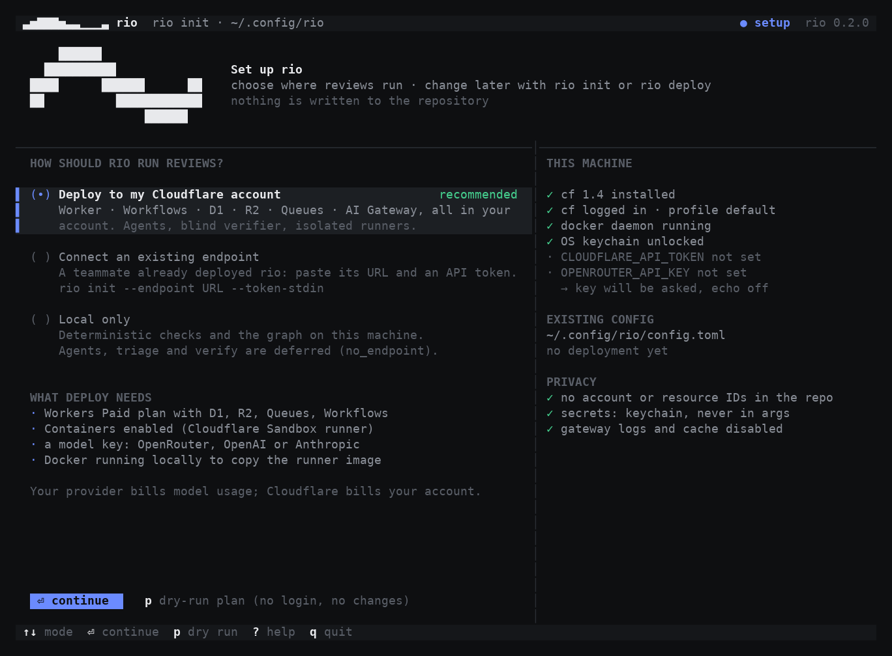
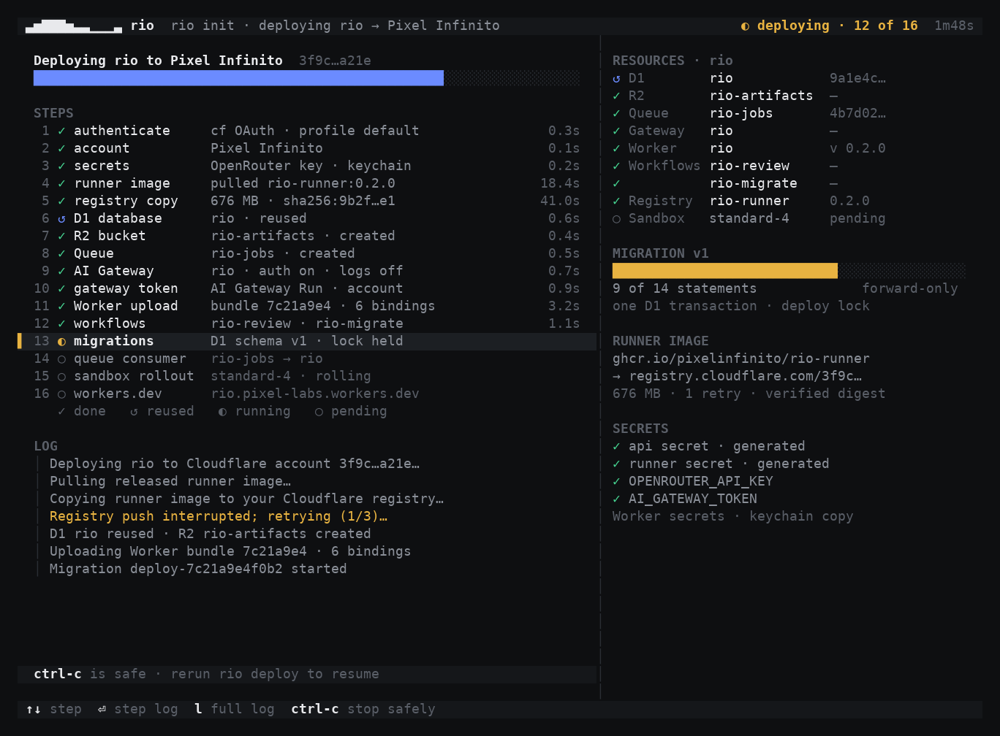

# Adicione revisão por IA: conecte ou implante

Hospede o backend do Rio na sua conta Cloudflare ou conecte ao endpoint da equipe para acrescentar revisores de IA e verificação independente às revisões pela CLI. As [verificações locais](review.md) funcionam sem essa configuração.

## Objetivo

Adicionar revisão por modelos e verificação independente usando infraestrutura na sua própria conta.

## Pré-requisitos

Para um endpoint existente: URL e token de API. Para nova implantação: Rio, CLI `cf` da Cloudflare com autenticação (ou `CLOUDFLARE_API_TOKEN`), serviços Workers/D1/R2/Queues/Containers elegíveis e chave de provedor de modelos. Sandbox exige Docker ativo para copiar a imagem pareada ao seu registro. Implantar com runner próprio não exige Docker na máquina de implantação, mas exige no host do runner. Recursos e chamadas podem gerar custos.

## Passos

### Conecte ao endpoint da equipe

Execute `rio init --endpoint https://SEU-ENDPOINT --token-stdin`, fornecendo o token pela entrada padrão de um gerenciador de segredos. Não coloque o token na URL nem nos argumentos do shell. Depois execute `rio doctor`.

### Implante seu endpoint

```sh
cf auth login
# Forneça OPENROUTER_API_KEY pelo ambiente privado.
rio init
rio review --profile rio/openrouter --preset standard
```

A configuração seleciona conta, nome, runner e provedor; depois cria Worker, Workflows, D1, R2, fila, AI Gateway e Sandbox opcional. O Worker é embutido: não exige checkout/npm/compilação Wrangler. `--no-tui` usa perguntas no terminal.

Use `rio deploy --dry-run` para inspecionar o plano offline sem alterações. `rio init --runner self-hosted --account ACCOUNT_ID` seleciona um runner Docker operado por você. Configure o host pareado de `rio-runner` com endpoint e segredo próprio do runner; a [referência de implantação](../../cloudflare.md#self-hosted-runner) contém o contrato exato de execução. Mantenha versões pareadas de runner, CLI e Worker.

### Inicie um runner próprio

Em um host Linux confiável com Docker, obtenha o código da versão correspondente do Rio e forneça `RIO_RUNNER_SECRET` (o `RUNNER_SECRET` do endpoint) pelo ambiente privado. A tag `local` abaixo identifica a imagem compilada desse código; não é uma versão distribuída. Execute:

```sh
docker build -f worker/Dockerfile -t rio-runner:local .
RIO_ENDPOINT_URL=https://rio.YOUR-SUBDOMAIN.workers.dev \
  cargo run --locked -p rio-runner -- serve --image rio-runner:local
```

Mantenha o processo de consulta ativo com seu gerenciador de serviços. Não monte o socket Docker, workspace do host ou credenciais nos contêineres de análise. O host Docker é confiável; dedique-o à execução de código de projetos não confiáveis.

## Resultados esperados

As escolhas ficam em `[deployment]` no `config.toml` pessoal; credenciais usam o chaveiro do sistema por padrão. `--credential-store file` seleciona explicitamente arquivos privados para servidores sem interface. `--from CONFIG` reutiliza escolhas; `rio deploy` atualiza/reutiliza recursos e retoma etapas interrompidas. Identificadores de conta/recursos não vão para o projeto.

## Solução de problemas

Confira perfil/conta do cf e serviços habilitados. Erros de Docker no Sandbox podem ser de transferência de imagem; runner próprio tem requisitos diferentes. Um chaveiro bloqueado exige desbloqueio ou escolha explícita de arquivos. Rotacione chaves pelo ambiente/arquivo privado e implante novamente. `--secrets-file` contém JSON privado, não um arquivo versionado do projeto.

`--default-model` e `--verifier-model` escolhem rotas. O perfil base não define modelos: implantar o endpoint não transforma todo perfil em perfil de IA. [Provedores](providers.md) explica rotas personalizadas.

## Próximos passos

[Defina limites](budgets.md), [configure provedores](providers.md) ou [conecte o GitHub](github.md).


## Capturas de tela



Escolha implantação ou conexão a endpoint existente. Dados demonstrativos · renderizador real do Rio · [Transcrição textual](../assets/init-i1-choose-mode.txt).



A implantação mostra etapa atual e alterações de recursos. Dados demonstrativos · renderizador real do Rio · [Transcrição textual](../assets/init-i3-deploying.txt).

<!-- commands:start -->

<details>
<summary>Todas as opções dos comandos</summary>

## Referência de comandos

### `rio init`

| Argumento | Significado | Padrão / valores |
| --- | --- | --- |
| `--endpoint` | Conecta este endpoint em vez de provisionar infraestrutura. | `—` |
| `--token-stdin` | Lê token do endpoint pela entrada padrão; exige --endpoint. | `false` |
| `--github-app` | Registra o GitHub App após implantação. | `false` |
| `--github-org` | Registra o App sob esta organização. | `—` |
| `--replace-private-key` | Lê PEM do GitHub App e atualiza o segredo no endpoint. | `—` |
| `--no-tui` | Usa perguntas no terminal em vez da tela interativa de configuração. | `false` |
| `--from` | Reutiliza escolhas de um arquivo pessoal de configuração. | `—` |
| `--account` | ID da conta Cloudflare para implantação. | `—` |
| `--name` | Prefixo de nomes dos recursos Cloudflare desta implantação. | `—` |
| `--cf-profile` | Seleciona o perfil de autenticação cf. | `—` |
| `--runner` | Escolhe Cloudflare Sandbox ou execução em runner próprio. | `sandbox, self-hosted` |
| `--runner-image` | Usa esta imagem pareada do runner. | `—` |
| `--workers-subdomain` | Seleciona subdomínio workers.dev da conta. | `—` |
| `--credential-store` | Escolhe chaveiro do sistema ou arquivos privados explícitos. | `keychain, file` |
| `--secrets-file` | Lê credenciais de JSON privado; não versione o arquivo. | `—` |
| `--custom-provider` | Registra SLUG:PROTOCOLO:URL_BASE; chaves são fornecidas privadamente. | `—` |
| `--default-model` | Rota padrão de modelo do perfil gerado. | `—` |
| `--verifier-model` | Seleciona a rota de modelo do verificador. | `—` |
| `--dry-run` | Mostra plano de implantação sem alterar credenciais ou conta. | `false` |
| `--council-vendor` | Adere a fornecedor do conselho como FORNECEDOR:FAMILIA:ROTA; repetível. | `—` |
| `--no-council` | Pula configuração opcional do conselho. | `false` |
| `--help` | Mostra sintaxe e opções do comando. | `—` |
### `rio deploy`

| Argumento | Significado | Padrão / valores |
| --- | --- | --- |
| `--from` | Reutiliza escolhas de um arquivo pessoal de configuração. | `—` |
| `--account` | ID da conta Cloudflare para implantação. | `—` |
| `--name` | Prefixo de nomes dos recursos Cloudflare desta implantação. | `—` |
| `--cf-profile` | Seleciona o perfil de autenticação cf. | `—` |
| `--runner` | Escolhe Cloudflare Sandbox ou execução em runner próprio. | `sandbox, self-hosted` |
| `--runner-image` | Usa esta imagem pareada do runner. | `—` |
| `--workers-subdomain` | Seleciona subdomínio workers.dev da conta. | `—` |
| `--credential-store` | Escolhe chaveiro do sistema ou arquivos privados explícitos. | `keychain, file` |
| `--secrets-file` | Lê credenciais de JSON privado; não versione o arquivo. | `—` |
| `--custom-provider` | Registra SLUG:PROTOCOLO:URL_BASE; chaves são fornecidas privadamente. | `—` |
| `--default-model` | Rota padrão de modelo do perfil gerado. | `—` |
| `--verifier-model` | Seleciona a rota de modelo do verificador. | `—` |
| `--dry-run` | Mostra plano de implantação sem alterar credenciais ou conta. | `false` |
| `--council-vendor` | Adere a fornecedor do conselho como FORNECEDOR:FAMILIA:ROTA; repetível. | `—` |
| `--no-council` | Pula configuração opcional do conselho. | `false` |
| `--help` | Mostra sintaxe e opções do comando. | `—` |

</details>

<!-- commands:end -->
