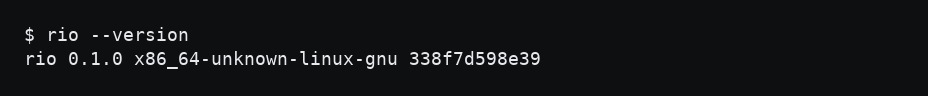
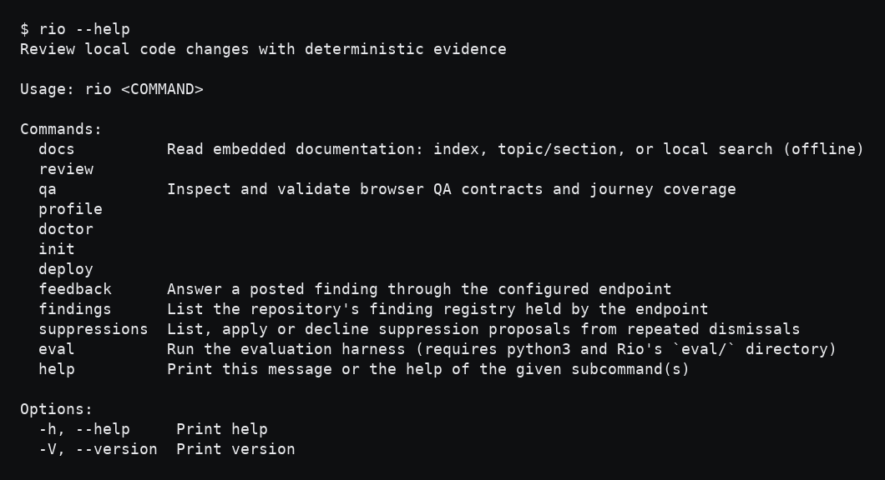

# Instale, atualize e remova o Rio

## Objetivo

Instalar um executável verificável, confirmar a versão em uso e saber como atualizá-lo ou removê-lo.

## Pré-requisitos

Linux, macOS ou Windows em x64/arm64; acesso ao GitHub. Por enquanto o Rio só tem pré-versões; o instalador escolhe a versão estável mais recente ou, enquanto não houver versão estável, a pré-versão mais recente. A compilação do código exige a versão do Rust em `rust-toolchain.toml`.

## Passos

No Linux/macOS, baixe e inspecione o instalador antes de executá-lo:

```sh
curl -fsSL https://raw.githubusercontent.com/pixelinfinito/rio/main/scripts/install.sh -o install.sh
less install.sh
sh install.sh
rio --version
```

No Windows PowerShell 5.1 ou 7:

```powershell
Invoke-WebRequest https://raw.githubusercontent.com/pixelinfinito/rio/main/scripts/install.ps1 -OutFile install.ps1
Get-Content install.ps1
.\install.ps1
rio --version
```

No Unix, o destino padrão é `~/.local/bin`; o instalador informa o ajuste de PATH sem alterar os arquivos do shell. No Windows, o padrão é `%LOCALAPPDATA%\Programs\rio\bin`, adicionado ao PATH do usuário; abra um novo terminal. `-NoModifyPath` desativa essa alteração.

Para fixar uma tag publicada, use `sh install.sh --version TAG --install-dir DIRETORIO` ou `-Version TAG -InstallDir DIRETORIO`, substituindo os valores. `RIO_VERSION` e `RIO_INSTALL_DIR` são equivalentes de ambiente; as opções do comando têm prioridade. Repetir a instalação atualiza ou rebaixa a versão após testar o novo executável. `RIO_DOWNLOAD_BASE` aceita um espelho HTTPS ou diretório local com arquivos e `SHA256SUMS`; a verificação continua obrigatória.

Em uma cópia do código: instale o Rust indicado e execute `cargo install --path crates/rio-cli --locked`. Compilações de arquivos sem Git podem definir `RIO_BUILD_VERSION` e `RIO_BUILD_COMMIT`.

## Resultados esperados

`rio --version` mostra versão, plataforma de destino e commit da compilação. Os instaladores verificam SHA-256 antes de instalar. Para verificar a procedência, execute `gh attestation verify ARQUIVO --repo pixelinfinito/rio` com o nome real do arquivo baixado.

## Solução de problemas

Comando não encontrado: confira diretório e PATH. Nenhuma versão encontrada: o instalador informa que nenhuma foi publicada; escolha uma tag existente ou compile o código; exemplos de versão não garantem disponibilidade. Divergência de checksum: interrompa e baixe novamente o arquivo e o checksum da mesma versão.

Remova com `sh install.sh --uninstall` ou `.\install.ps1 -Uninstall`; a configuração pessoal é preservada. Acrescente `--purge`/`-Purge` somente para apagá-la também. Os equivalentes são `RIO_UNINSTALL=1` e `RIO_PURGE=1`. Instalações pelo código usam `cargo uninstall rio-cli`. Caches de repositórios precisam de limpeza separada e deliberada.

## Próximos passos

[Execute a primeira revisão local](review.md).

## Capturas de tela



Confira versão, plataforma e commit instalados. Dados demonstrativos · renderizador real do Rio · [Transcrição textual](../assets/cli-version.txt).



A ajuda inicial lista os fluxos disponíveis. Dados demonstrativos · renderizador real do Rio · [Transcrição textual](../assets/cli-help.txt).

