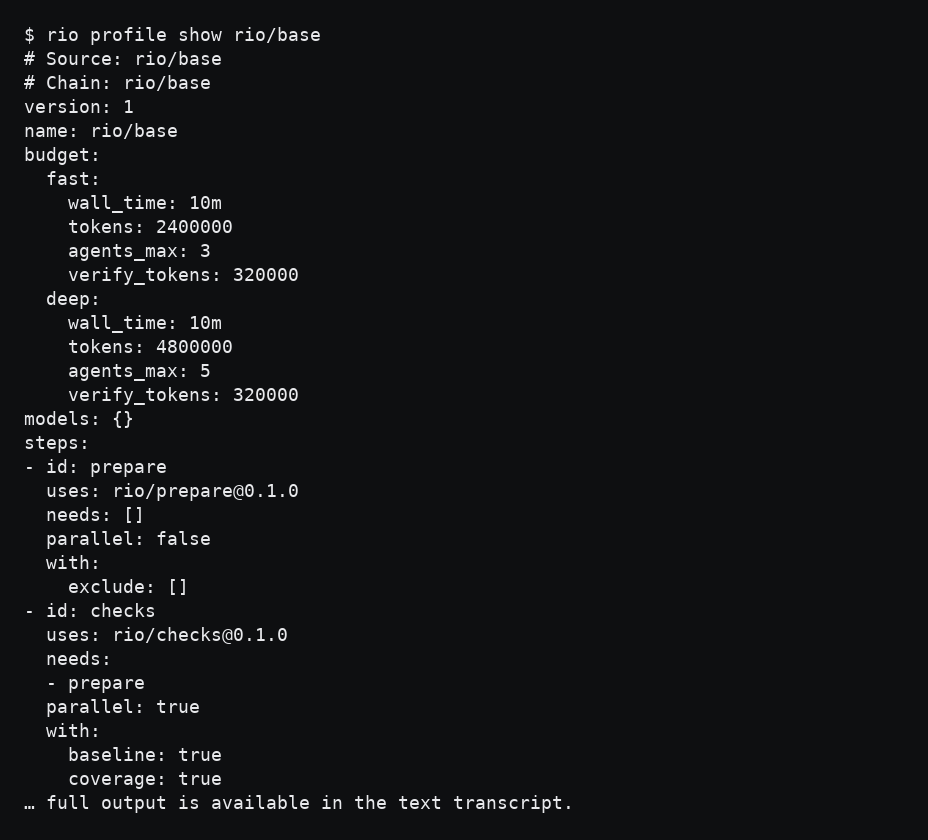

# Ajuste verificações com perfis

## Objetivo

Alterar o comportamento da revisão de forma deliberada e validar antes de executar ferramentas ou modelos.

## Pré-requisitos

Um projeto e a política desejada. A política do repositório fica em `.rio/profiles/default.yaml`; padrões pessoais ficam em `profiles/` no diretório de configuração do usuário. Credenciais e limites da máquina pertencem à [configuração pessoal](configuration.md).

## Passos

```sh
rio profile list
rio profile show rio/base
rio profile show strict --raw
rio profile validate
```

O padrão é escolhido no repositório, depois no diretório pessoal e, por fim, em `rio/base`. Perfis nomeados são buscados no repositório/diretório pessoal/integrados; caminhos explícitos também funcionam. `rio review --profile strict` seleciona um perfil nomeado.

### Exija ferramentas essenciais

Salve como `.rio/profiles/default.yaml`:

```yaml
version: 1
name: strict
extends: rio/base
fail_on:
  required_checks: [typecheck, lint]
```

Valide com `rio profile validate`. Ferramentas obrigatórias ausentes passam a afetar a política, em vez de serem apenas verificações opcionais ignoradas.

### Desative cobertura em um fluxo local pequeno

Mapas são combinados, mas **listas substituem toda a lista herdada**. Este pipeline local completo mantém intencionalmente apenas prepare/checks/graph/report:

```yaml
version: 1
name: local-quick
extends: rio/base
steps:
  - id: prepare
    uses: rio/prepare
    with: {exclude: ['generated/**']}
  - id: checks
    uses: rio/checks
    needs: [prepare]
    with: {coverage: false}
  - id: graph
    uses: rio/graph
    needs: [prepare]
  - id: report
    uses: rio/report
    needs: [checks, graph]
```

Para um perfil hospedado, parta das etapas resolvidas e preserve as etapas de modelos/verificação desejadas. Não copie somente checks supondo que as demais continuarão presentes.

## Resultados esperados

`rio profile show` mostra a herança aplicada e as versões dos módulos fixadas. A validação retorna 0 quando válida e 2 com caminhos YAML nos erros. Ela pode avisar que etapas de modelos serão adiadas localmente sem rejeitar um perfil válido.

`fail_on.incomplete: false` muda a política de saída por análise incompleta; `suppress` aceita caminho/regra/ID exato; `publish` controla never/ask/auto. A postura ajusta evidência/severidade/quantidade dos agentes: critical-only, balanced ou thorough. [Limites](budgets.md) controla recursos; a [referência de módulos](modules.md) explica opções de etapas. Os campos gerados do schema documentam as chaves suportadas.

## Solução de problemas

Módulos desconhecidos, ciclos em `extends` ou `needs` e opções inválidas impedem a validação. Listas substituem, mapas vazios preservam os valores do pai e caminhos relativos de pais são resolvidos a partir do arquivo que os declara. Examine o YAML resolvido antes de executar. Suprimir remove achados da política; não corrige o código.

## Próximos passos

[Consulte módulos e campos](modules.md), [defina limites de modelos](budgets.md) ou [use propostas de supressão](suppressions.md).


## Capturas de tela



Examine o perfil base resolvido antes de substituir etapas. Dados demonstrativos; captura da CLI/renderizador TUI atual. [Transcrição textual](../assets/cli-profile.txt).

<!-- commands:start -->

## Referência de comandos

### `rio profile`

| Argumento | Significado | Padrão / valores |
| --- | --- | --- |
| `--help` | Mostra sintaxe e opções do comando. | `—` |
### `rio profile list`

| Argumento | Significado | Padrão / valores |
| --- | --- | --- |
| `--help` | Mostra sintaxe e opções do comando. | `—` |
### `rio profile show`

| Argumento | Significado | Padrão / valores |
| --- | --- | --- |
| `<reference>` | Nome/caminho do perfil; validate sem argumento usa o padrão. | `—` |
| `--raw` | Mostra perfil original sem resolver herança. | `false` |
| `--help` | Mostra sintaxe e opções do comando. | `—` |
### `rio profile validate`

| Argumento | Significado | Padrão / valores |
| --- | --- | --- |
| `<reference>` | Nome/caminho do perfil; validate sem argumento usa o padrão. | `—` |
| `--help` | Mostra sintaxe e opções do comando. | `—` |

<!-- commands:end -->
