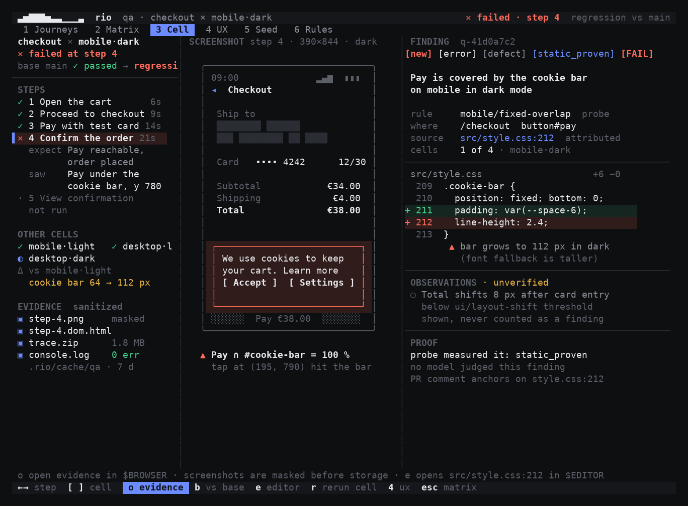
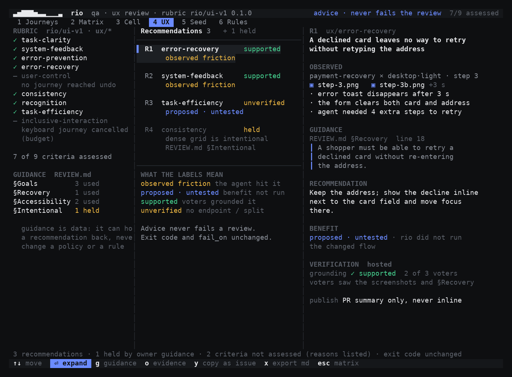

# Examine evidências de QA e recomendações de UX

## Objetivo

Entender o que foi observado em cada célula do navegador e gerenciar artefatos retidos.

## Pré-requisitos

Execução QA com dados sintéticos e mascaramento adequado. Operações hospedadas exigem endpoint/token. Artefatos podem conter dados da aplicação; trate-os como informações sensíveis do projeto.

## Passos

Abra uma célula da matriz na TUI e examine capturas, DOM e rastros dos passos junto de resultados base/alteração e citações das orientações. Em larguras menores, `v` alterna detalhes e captura. Exporte o relatório para análise durável.

Distinga sondagens determinísticas de interface, falhas funcionais e recomendações de UX do modelo. A recomendação explica atrito observado e melhoria proposta; o benefício da melhoria não foi comprovado pela execução atual. Uma jornada aprovada pode ter recomendações, que não causam falha de política. Sem endpoint, observações/recomendações avaliadas continuam explicitamente não verificadas.

## Resultados esperados

Artefatos se relacionam a jornada/viewport/esquema de cor e versão. Relatórios preservam células ausentes/falhas/canceladas em vez de considerá-las aprovadas. Capturas hospedadas baixadas ficam em `qa-images` da execução por sete dias, até 200 MB. Citações permitem relacionar afirmações à interface real.

## Solução de problemas

Em uma célula falha, confira primeiro prontidão da aplicação/dados, depois hosts bloqueados e o passo. Tempo esgotado do modelo/ferramenta significa evidência incompleta. O terminal pode limitar imagens embutidas; evidências textuais e artefatos exportados continuam disponíveis.

Para apagar deliberadamente evidências hospedadas, execute `rio qa evidence prune --review REVIEW_ID` com o ID real. Isso remove objetos e revoga links de download; preserve primeiro o necessário para revisões em andamento. Apagar um download local não remove objetos remotos, e desinstalar não limpa todos os caches.

## Próximos passos

[Corrija cobertura das jornadas](qa-journeys.md), [ajuste limites](budgets.md) ou [gerencie privacidade do cache](cache.md).

## Capturas de tela

Examine o passo falho e artefatos. Dados demonstrativos · renderizador real do Rio · [Transcrição textual](../assets/qa-q3-cell-detail.txt).

Separe atrito observado de benefício proposto. Dados demonstrativos · renderizador real do Rio · [Transcrição textual](../assets/qa-q4-ux-recommendations.txt).

<!-- commands:start -->

Todas as opções dos comandos

## Referência de comandos

### `rio qa evidence`

| Argumento | Significado | Padrão / valores |
| --- | --- | --- |
| `--help` | Mostra sintaxe e opções do comando. | `—` |
### `rio qa evidence prune`

| Argumento | Significado | Padrão / valores |
| --- | --- | --- |
| `--review` | ID da revisão cujas evidências QA hospedadas serão apagadas. | `—` |
| `--help` | Mostra sintaxe e opções do comando. | `—` |

<!-- commands:end -->
