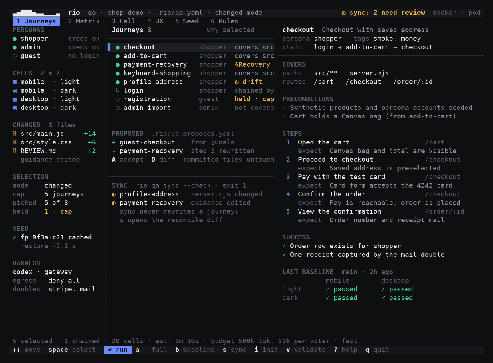
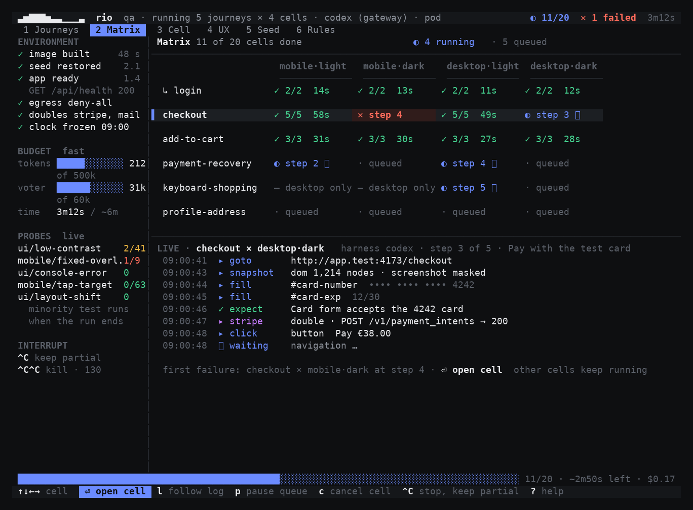

# Sua primeira execução de QA no navegador

## Objetivo

Exercitar jornadas reais em navegadores isolados e inspecionar evidências funcionais, de acessibilidade e experiência de uso.

## Pré-requisitos

Repositório Git da aplicação, host Linux com Docker e controle de firewall, imagem QA pareada, contrato de inicialização, dados/fixtures sintéticos e autenticação do modelo. A ferramenta de autoria aceita `codex` ou `pi`; use a assinatura local ou rota do chaveiro suportada. Não copie credenciais/dados de produção. Avaliações locais permanecem não verificadas sem endpoint.

## Passos

Compile a imagem pareada na cópia do código do Rio:

```sh
docker build -f worker/Dockerfile.qa -t rio-qa:0.1.0 .
```

Na aplicação, defina `.rio/qa.yaml`. O exemplo ilustra uma aplicação Node em imagem; ajuste porta/comando/Dockerfile ao projeto:

```yaml
version: 1
app:
  packaging: image
  dockerfile: Dockerfile.qa
  start: npm run build && node server.mjs
  url: http://app.test:4173
  ready: {path: /api/health, status: 200}
personas:
  - name: guest
    description: A visitor without an account
browser:
  viewports: [mobile, desktop]
  color_schemes: [light, dark]
```

Use a [aplicação de exemplo completa](../../../tests/fixtures/qa-sample/README.md) para aprender dados iniciais e serviços simulados. Escreva `REVIEW.md` com objetivos e escolhas intencionais. Depois, no repositório da aplicação:

```sh
rio qa validate
rio qa seed build
rio qa init
rio qa list
rio qa --full
```

Init pode propor configuração ausente; revise `.rio/qa.proposed.yaml` antes de `rio qa init --accept-contract`. Jornadas existentes recebem propostas; `--force` permite substituição validada de jornadas, mas não aceita contrato nem sobrescreve definições arbitrárias. Edições concorrentes são protegidas.

## Resultados esperados

A matriz mostra jornada × viewport × esquema de cor. `rio qa` seleciona cobertura alterada; `--full`, tudo; `--journey NOME` repetido, jornadas específicas e pré-requisitos. `--baseline` compara base/alteração; `--cell mobile/dark` restringe a uma célula válida. `--staged`/`--base REF` escolhem o código como na revisão. O padrão é `rio/qa`; perfis próprios precisam habilitar QA.

`rio qa show` mostra o ambiente resolvido, `show NOME` uma jornada e `rules` a rubrica. Use `--format json` para automação. Recomendações de UX podem surgir em jornadas aprovadas e não causam falha; atrito observado e benefício previsto permanecem distintos.

## Solução de problemas

Valide antes de iniciar. Confira imagem, prontidão da aplicação e autenticação. Use `app.test`, não apenas `app`, para evitar atualização HSTS no Chromium. Projetos somente Compose ou desconhecidos podem exigir `Dockerfile.qa` revisado ou contrato proposto. Dependências bloqueadas são relatadas; não significam jornada aprovada.

## Próximos passos

[Crie jornadas](qa-journeys.md), [prepare dados e fixtures](qa-seeds.md) e [examine evidências](qa-evidence.md).


## Capturas de tela



Selecione jornadas e examine dependências. Dados demonstrativos · renderizador real do Rio · [Transcrição textual](../assets/qa-q1-journeys.txt).



Acompanhe resultados por viewport e esquema de cor. Dados demonstrativos · renderizador real do Rio · [Transcrição textual](../assets/qa-q2-matrix-live.txt).

<!-- commands:start -->

<details>
<summary>Todas as opções dos comandos</summary>

## Referência de comandos

### `rio qa`

| Argumento | Significado | Padrão / valores |
| --- | --- | --- |
| `--staged` | Seleciona somente alterações preparadas (staged) contra HEAD; conflita com --base. | `false` |
| `--base` | Compara os commits do HEAD com a base comum desta referência. | `—` |
| `--profile` | Seleciona perfil nomeado ou caminho YAML explícito. | `—` |
| `--format` | Escolhe formato de saída; valores suportados são listados. | `terminal, json, md, sarif` |
| `--no-tui` | Usa saída contínua ou perguntas no terminal em vez da TUI. | `false` |
| `--no-color` | Desativa cores ANSI. | `false` |
| `--ascii` | Usa símbolos ASCII no terminal (também RIO_ASCII=1). | `false` |
| `--publish` | Solicita publicação conforme política hospedada; altera recursos remotos. | `false` |
| `--full` | Executa todas as jornadas QA; conflita com --journey explícito. | `false` |
| `--journey` | Seleciona jornada e pré-requisitos; repetível. | `—` |
| `--baseline` | Executa QA na base e na alteração. | `false` |
| `--harness` | Seleciona ferramenta de autoria/execução QA. | `codex, pi` |
| `--cell` | Seleciona uma célula viewport/esquema de cor. | `—` |
| `--help` | Mostra sintaxe e opções do comando. | `—` |
### `rio qa init`

| Argumento | Significado | Padrão / valores |
| --- | --- | --- |
| `--force` | Substitui jornadas versionadas após validar o lote gerado; não aceita contrato de inicialização. | `false` |
| `--accept-contract` | Aceita o contrato QA proposto e revisado. | `false` |
| `--help` | Mostra sintaxe e opções do comando. | `—` |
### `rio qa validate`

| Argumento | Significado | Padrão / valores |
| --- | --- | --- |
| `--help` | Mostra sintaxe e opções do comando. | `—` |
### `rio qa list`

| Argumento | Significado | Padrão / valores |
| --- | --- | --- |
| `--help` | Mostra sintaxe e opções do comando. | `—` |
### `rio qa show`

| Argumento | Significado | Padrão / valores |
| --- | --- | --- |
| `<name>` | Nome da jornada a inspecionar; omita para mostrar o ambiente QA resolvido. | `—` |
| `--help` | Mostra sintaxe e opções do comando. | `—` |
### `rio qa rules`

| Argumento | Significado | Padrão / valores |
| --- | --- | --- |
| `--help` | Mostra sintaxe e opções do comando. | `—` |

</details>

<!-- commands:end -->
