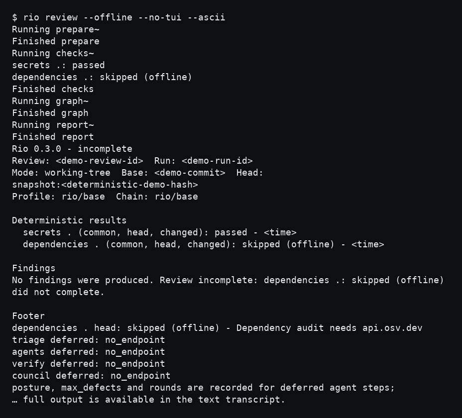

# Sua primeira revisão local

## Objetivo

Revisar uma pequena alteração, entender o que foi verificado e decidir o que corrigir. As verificações locais não exigem conta Cloudflare nem chave de modelo.

## Pré-requisitos

[Instale o Rio](installation.md), abra uma árvore de trabalho Git e instale as dependências e ferramentas do próprio projeto. TypeScript usa tsc/ESLint/Vitest ou Jest; Python usa Pyright ou mypy/Ruff/pytest/coverage.py; Rust usa Cargo e, opcionalmente, Clippy/rustfmt/llvm-cov. O Rio não instala essas ferramentas.

## Passos

1. Faça uma alteração pequena e intencional no código do projeto.
2. Execute `rio doctor` e resolva os impedimentos indicados.
3. Execute `rio review --no-tui` para saída contínua ou `rio review` para a [interface interativa](tui.md).
4. Leia os resultados das verificações antes dos achados. Corrija um problema confirmado e execute novamente.

Escolha uma seleção local ou a revisão hospedada de um PR:

| Comando | O que revisa |
| --- | --- |
| `rio review` | Árvore de trabalho, alterações preparadas e arquivos novos não ignorados contra HEAD |
| `rio review --staged` | Índice contra HEAD; exclui alterações não preparadas |
| `rio review --base origin/main` | Commits do HEAD contra a base comum; exclui edições locais |
| `rio review --pr 123` | Revisa um PR do GitHub pelo [endpoint e App instalado](github.md) |

Para agentes ou CI, use `rio review --format json > report.json`. `--format md` gera Markdown e `--format sarif` gera dados para análise de código. O progresso vai para stderr. `--profile NOME_OU_CAMINHO` escolhe um [perfil](profiles.md).

Escolha as alterações antes de executar. Dados demonstrativos · [Transcrição textual](../assets/review-00-start.txt).

## Resultados esperados

A saída identifica a seleção, o perfil e a execução, as verificações aprovadas/com achados/falhas/ignoradas e os achados com evidências. Sem endpoint, as etapas de modelos aparecem como adiadas. Uma árvore sem alterações produz “No changes to review”. Nenhum achado com verificações ignoradas ou falhas não comprova uma revisão completa.

## Solução de problemas

`dependency_mismatch`: sincronize as dependências instaladas com o lockfile selecionado. Ferramenta ausente: instale a versão fixada pelo projeto. `--offline` impede a rede do Rio, incluindo auditoria online, mas não isola ferramentas e testes. Use isolamento externo se necessário.

Índices com conflitos são recusados nas seleções local/preparada. Comparações de branches precisam do histórico da base comum; aprofunde clones rasos. Disponibilize os objetos de clones parciais antes da revisão: o Rio não os busca. Repositórios bare são recusados; submódulos permanecem gitlinks e arquivos LFS permanecem ponteiros. Worktrees vinculadas e checkouts esparsos funcionam com essas limitações.

O primeiro Ctrl-C preserva um relatório parcial; o segundo encerra os processos restantes e retorna 130. Veja [resultados e códigos de saída](results.md) antes de tratar toda saída diferente de zero como erro interno.

## Próximos passos

[Entenda os resultados](results.md), [ajuste as verificações](profiles.md) ou [habilite revisão por IA](hosting.md).

## Capturas de tela

Revisão offline real de alteração documental sintética; etapas de modelos são adiadas. Dados demonstrativos · renderizador real do Rio · [Transcrição textual](../assets/cli-review.txt).

<!-- commands:start -->

Todas as opções dos comandos

## Referência de comandos

### `rio review`

| Argumento | Significado | Padrão / valores |
| --- | --- | --- |
| `--staged` | Seleciona somente alterações preparadas (staged) contra HEAD; conflita com --base. | `false` |
| `--base` | Compara os commits do HEAD com a base comum desta referência. | `—` |
| `--profile` | Seleciona perfil nomeado ou caminho YAML explícito. | `—` |
| `--format` | Escolhe formato de saída; valores suportados são listados. | `terminal, json, md, sarif` |
| `--offline` | Desativa rede do Rio; subprocessos não são isolados da rede. | `false` |
| `--no-color` | Desativa cores ANSI. | `false` |
| `--ascii` | Usa símbolos ASCII no terminal (também RIO_ASCII=1). | `false` |
| `--no-tui` | Usa saída contínua ou perguntas no terminal em vez da TUI. | `false` |
| `--show-pre-existing` | Inclui achados preexistentes da base na saída. | `false` |
| `--show-remembered` | Lista dispensas lembradas separadamente sem mudar política de saída. | `false` |
| `--pr` | Número do pull request do GitHub; exige endpoint e GitHub App instalado. | `—` |
| `--deep` | Usa preset deep; conflita com --preset. | `false` |
| `--preset` | Seleciona profundidade; exige endpoint online. | `quick, standard, deep` |
| `--fork` | Marca submissão local hospedada como fork; endpoint valida metadados de PR. | `false` |
| `--nightly` | Marca execução noturna de avaliação para gatilhos do conselho. | `false` |
| `--publish` | Solicita publicação conforme política hospedada; altera recursos remotos. | `false` |
| `--since-last` | Continua a linhagem da branch no endpoint. | `false` |
| `--reset-lineage` | Inicia nova geração da linhagem; exige --since-last. | `false` |
| `--help` | Mostra sintaxe e opções do comando. | `—` |

<!-- commands:end -->
