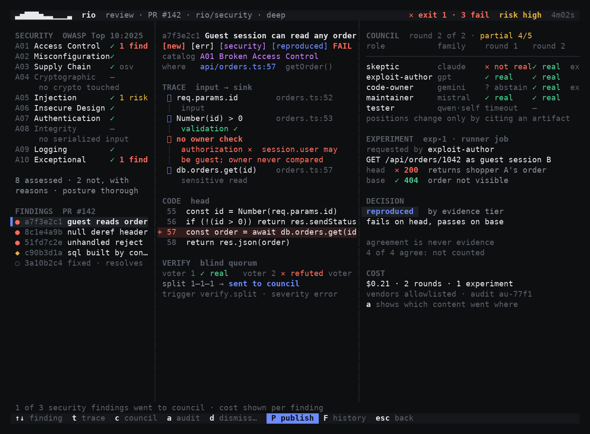

# Revise segurança com evidências

## Objetivo

Avaliar controles relevantes e entender quais itens do catálogo foram realmente examinados.

## Pré-requisitos

IA hospedada para o agente de segurança; detecção local de segredos funciona separadamente. O perfil de segurança também habilita membros provisórios do conselho, que exigem adesão de fornecedores. Evidências podem chegar aos provedores configurados.

## Passos

```sh
rio profile show rio/security
rio review --profile rio/security
```

A etapa `rio/security` é desativada em `rio/base`. O perfil de segurança integrado usa postura thorough e `asvs-5.0`; a etapa também aceita `owasp-top10-2025`. São IDs de catálogo, não caminhos arbitrários. Ao personalizar a lista de etapas, preserve todas as desejadas e suas dependências de verificação.

Leia os itens avaliados, não avaliados e não aplicáveis. Um rastreamento explica origem, passos intermediários e destino; proteção ausente não significa automaticamente exploração reproduzida. Severidade e evidência respondem perguntas diferentes.

## Resultados esperados

Segurança tem um conjunto próprio de evidência/apresentação. `with.fail_on` na etapa de segurança considera por padrão achados novos/agravados de segurança com evidência plausible ou superior. Essa política ou a política geral pode causar falha antes dos limites de apresentação. Itens plausíveis continuam sendo riscos para avaliação humana; análise não é certificação.

Orientações dos responsáveis são consideradas junto das evidências, mas não habilitam ferramentas nem ignoram limites/políticas. Itens não avaliados explicam limitações de tempo/evidência/ferramentas e não podem ser apresentados como revisão de segurança aprovada. Em PRs de forks, a análise de segurança é somente estática.

## Solução de problemas

Confira habilitação da etapa, rota de modelo, catálogo e dependências de verificação. Fornecedores ausentes afetam o conselho separadamente do agente. Critérios de aceitação pendentes continuam pendentes mesmo com implementação/testes. Não substitua controles não avaliados por alegações de cobertura.

## Próximos passos

[Entenda o conselho](council.md), [ajuste a política](profiles.md) ou [inspecione os resultados](results.md).

## Capturas de tela



Leia rastreamento e evidências do conselho juntos. Dados demonstrativos · renderizador real do Rio · [Transcrição textual](../assets/team-p1-security-council.txt).

