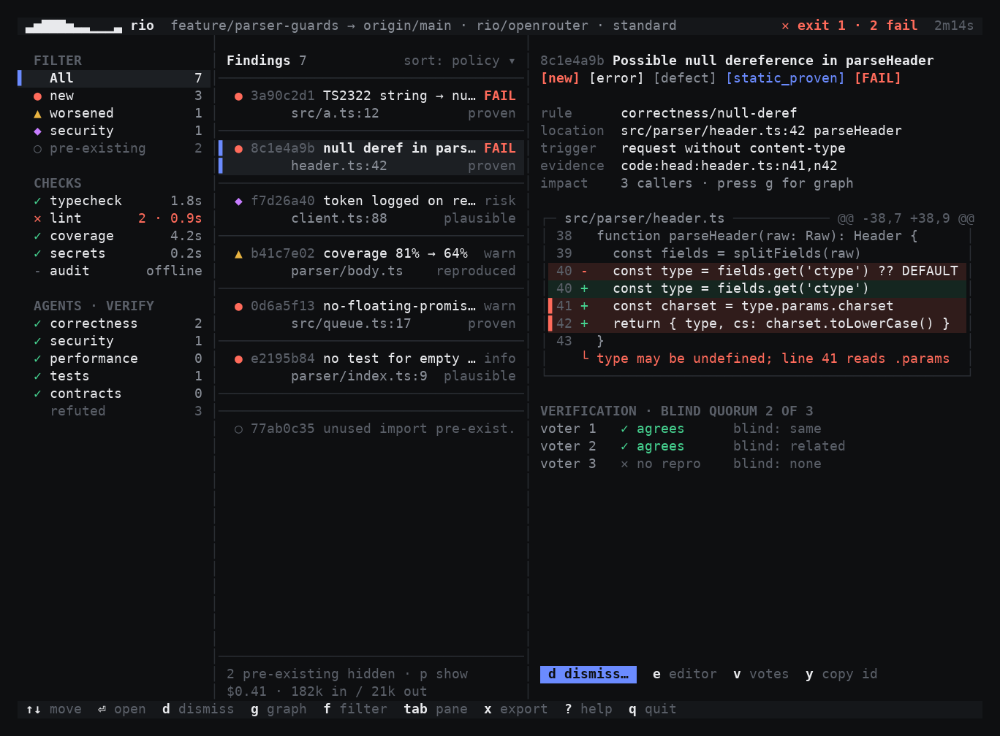
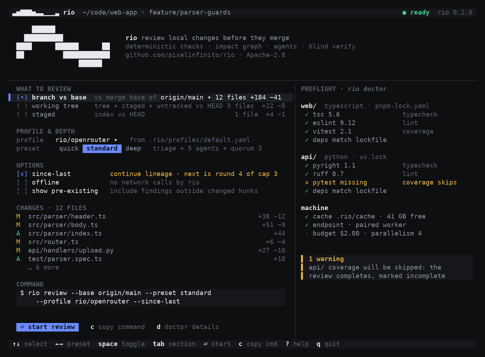

# Rio — revisão de código no seu terminal

Revise suas alterações **antes do merge**, no lugar onde você já trabalha. O Rio verifica edições ainda não commitadas, arquivos preparados (staged), branches e pull requests do GitHub. Ele reúne verificações de tipos, lint, testes e segurança do projeto em uma revisão, para você ver o que executou, o que falhou e quais linhas precisam de atenção.

**Comece localmente com `rio review`.** As verificações locais não exigem conta na nuvem nem chave de API. Adicione revisão por IA quando quiser revisores de modelos e verificação independente.



*Revisão de uma branch com IA hospedada habilitada: examine um achado, seu código e as evidências. Dados demonstrativos · renderizador real do Rio · [Transcrição textual](../assets/review-02-findings.txt). A interface é em inglês.*

## Comece com uma revisão local

[Instale o Rio](installation.md), abra um projeto Git e instale as dependências desse projeto. Execute:

```sh
rio doctor     # Confira quais ferramentas estão prontas
rio review     # Revise suas alterações locais
```

O Rio abre a interface interativa quando o terminal oferece suporte. Use `rio review --no-tui` para saída simples ou `rio review --format json` para scripts e agentes. Também há exportação em Markdown (`--format md`) e SARIF (`--format sarif`).

Leia as verificações junto com os achados: ferramentas ausentes ou verificações ignoradas indicam uma revisão incompleta. [Siga a primeira revisão passo a passo →](review.md)

## Escolha o que revisar

| Suas alterações | Comando | O que você precisa |
| --- | --- | --- |
| Edições não commitadas, incluindo arquivos preparados e novos não ignorados | `rio review` | Projeto Git e suas ferramentas |
| Apenas arquivos preparados (staged) | `rio review --staged` | Alterações adicionadas ao índice |
| Commits da branch desde a separação de `origin/main` | `rio review --base origin/main` | Referência base e histórico disponíveis localmente |
| Um pull request do GitHub | `rio review --pr 123` | [Endpoint e GitHub App configurados](github.md) |
| Jornadas de usuários em uma aplicação web | `rio qa` | [Ambiente de QA configurado](qa.md) |



*Escolha as alterações e o perfil antes de começar. Dados demonstrativos; as versões exibidas são valores da fixture · [Transcrição textual](../assets/review-00-start.txt).*

## Três formas de usar o Rio

| Fluxo | O que oferece | Preparação |
| --- | --- | --- |
| **Revisão local de código** | Verificação de tipos, lint, cobertura de testes das linhas alteradas, busca de segredos, auditoria de dependências e grafo de impacto | Rio e ferramentas do projeto. TypeScript, Python e Rust têm adaptadores integrados. A auditoria de dependências usa a rede. [Primeira revisão](review.md) |
| **Revisão por IA** | Modelos apontam problemas; verificadores independentes avaliam as evidências. Acrescenta revisão de PRs e colaboração em equipe. | Endpoint na sua conta Cloudflare (ou da equipe), runner e credenciais de modelos. [Conecte ou implante](hosting.md) |
| **QA no navegador** | Jornadas em diferentes tamanhos de tela e temas, com evidências funcionais, de acessibilidade e UX | Host Linux com Docker e controle de firewall, imagem de QA, acesso a modelo e contratos da aplicação/fixtures. [Configure o QA](qa.md) |

Sem endpoint, as etapas de revisão por IA ficam **adiadas**; as verificações locais disponíveis continuam executando. QA no navegador tem requisitos próprios de modelo e ambiente. `--offline` interrompe requisições do Rio; não isola testes ou ferramentas do projeto da rede. [Dados e privacidade](cache.md)

## Encontre o próximo passo

- **Entenda um resultado:** [Achados e códigos de saída](results.md) · [Controles do terminal](tui.md)
- **Ajuste a revisão:** [Perfis e verificações](profiles.md) · [Limites de modelos](budgets.md)
- **Trabalhe com a equipe:** [Pull requests](github.md) · [CI e análise de código](ci.md)
- **Encontre ajuda:** [Solução de problemas](troubleshooting.md) · [Todos os guias](guides.md) · [Referência de comandos e configurações](reference.md)
- **Use um agente de código:** `rio docs` oferece ajuda compacta, offline e compatível com o executável instalado. [Documentação para agentes](docs.md)

## Disponibilidade

O Rio tem alvos para Linux, macOS e Windows em x64/arm64. Veja na instalação as versões disponíveis ou como compilar o código. Estas páginas descrevem a versão do código no rodapé; uma versão distribuída pode ser diferente.

O Rio ainda é pré-1.0, e a avaliação de qualidade registrada não está concluída. Use os achados como apoio à revisão e examine as evidências. [Detalhes da avaliação](evaluation.md)
