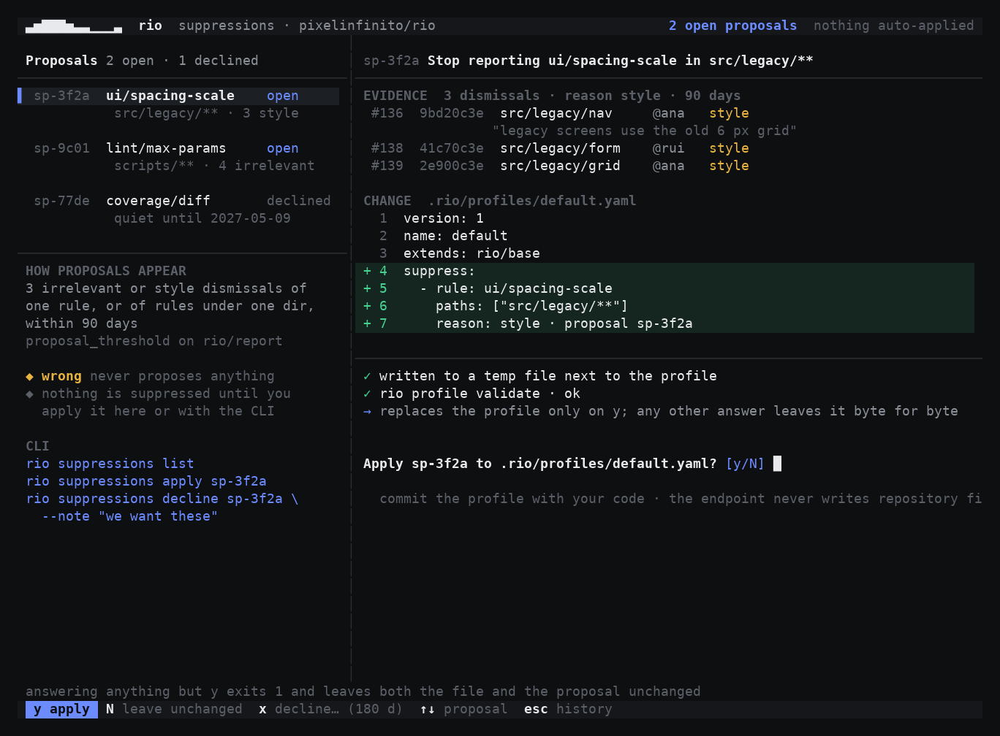

# Aplique ou recuse propostas de supressão

## Objetivo

Transformar feedback repetido de irrelevância/estilo em uma mudança explícita e revisável de política.

## Pré-requisitos

Endpoint/token e repositório. Aplicar escreve `.rio/profiles/default.yaml`; recusar altera a proposta no endpoint. Examine as evidências antes.

## Passos

```sh
rio suppressions list --format json
rio suppressions apply PROPOSAL_ID
rio suppressions decline PROPOSAL_ID --note "continuar relatando esta regra"
```

Escolha aplicar **ou** recusar para um ID real de proposta. A listagem aceita estados `proposed`, `applied` e `declined`. Por padrão, três dispensas compatíveis em 90 dias podem gerar uma proposta de regra/diretório. Uma proposta sozinha não suprime nada.

Aplicar mostra entrada/evidências e pede confirmação. Somente `y` prossegue; outras respostas preservam arquivo/proposta e retornam 1. `--yes` desativa deliberadamente essa pergunta. Sem perfil padrão, o Rio cria um estendendo `rio/base`. Ele grava e valida um arquivo temporário vizinho antes de substituir o perfil; falha de validação/gravação preserva os bytes originais. Versione a mudança de política com o código.

## Resultados esperados

Entradas aplicadas aparecem em `suppress`, e o endpoint marca a proposta. Recusar evita propor a mesma entrada por 180 dias. A TUI oferece propostas por `S` e exige confirmação para aplicar.

## Solução de problemas

IDs de propostas diferem de IDs de achados. Falhas de uso/configuração/validação geralmente retornam 2; falhas de endpoint/repositório/persistência retornam 3. Se a aplicação local funcionar, mas a marcação remota falhar, examine ambos antes de repetir: falha remota não prova que o arquivo local permaneceu intacto. Supressão é decisão de política, não evidência de correção.

## Próximos passos

[Valide o perfil resultante](profiles.md) e [consulte o histórico](feedback.md).


## Capturas de tela



Examine evidências antes de alterar o perfil. Dados demonstrativos; captura da CLI/renderizador TUI atual. [Transcrição textual](../assets/team-p4-suppression-proposals.txt).

<!-- commands:start -->

## Referência de comandos

### `rio suppressions`

| Argumento | Significado | Padrão / valores |
| --- | --- | --- |
| `--help` | Mostra sintaxe e opções do comando. | `—` |
### `rio suppressions list`

| Argumento | Significado | Padrão / valores |
| --- | --- | --- |
| `--status` | Filtra estado pelos valores aceitos listados. | `proposed, applied, declined` |
| `--format` | Escolhe formato de saída; valores suportados são listados. | `terminal, json` |
| `--help` | Mostra sintaxe e opções do comando. | `—` |
### `rio suppressions apply`

| Argumento | Significado | Padrão / valores |
| --- | --- | --- |
| `<id>` | Prefixo de achado (mínimo 8 caracteres) ou ID de proposta, conforme o comando. | `—` |
| `--yes` | Aplica proposta de supressão sem perguntar confirmação. | `false` |
| `--help` | Mostra sintaxe e opções do comando. | `—` |
### `rio suppressions decline`

| Argumento | Significado | Padrão / valores |
| --- | --- | --- |
| `<id>` | Prefixo de achado (mínimo 8 caracteres) ou ID de proposta, conforme o comando. | `—` |
| `--note` | Acrescenta explicação ao feedback ou recusa de proposta. | `—` |
| `--help` | Mostra sintaxe e opções do comando. | `—` |

<!-- commands:end -->
