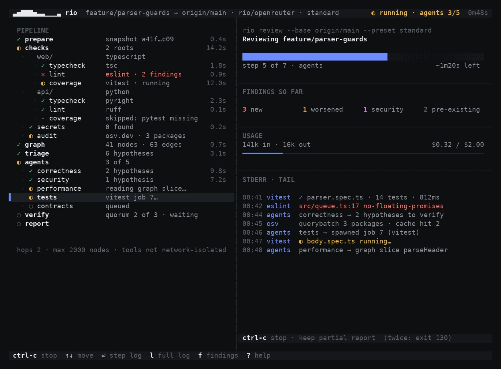
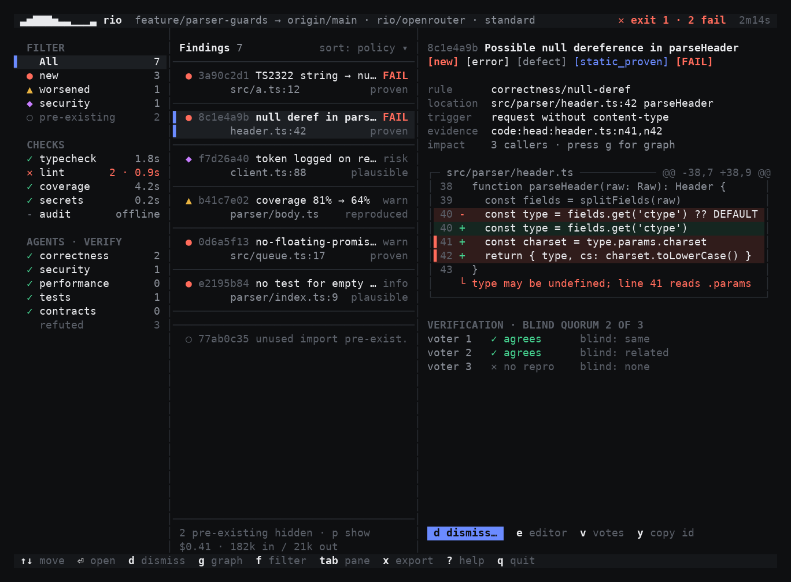
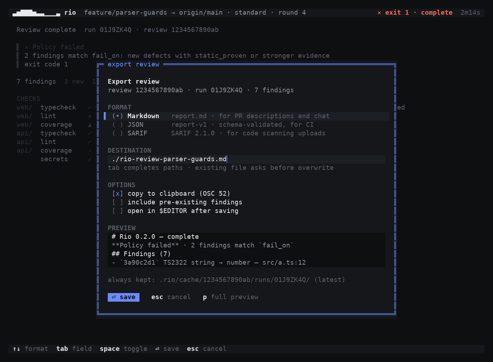

# Use o terminal interativo

## Objetivo

Ir da seleção aos achados, evidências e exportação sem memorizar todas as opções da CLI.

## Pré-requisitos

Terminal interativo com entrada/saída conectadas, no mínimo 80×24 células, sem `--format` explícito e sem `CI` definido. Revisão, QA e configuração têm telas interativas. A interface continua em inglês; esta Wiki traduz suas explicações.

## Passos

Execute `rio review`. Escolha seleção/perfil/profundidade, acompanhe as verificações e abra um achado para inspecionar trecho e verificação. Use a exportação para salvar o relatório.

| Tecla | Ação |
| --- | --- |
| `?` / `:` | Ajuda e mapa de telas / paleta de comandos |
| Tab | Próximo painel |
| Setas ou `j`/`k` | Mover |
| Enter / Esc | Abrir / voltar |
| `/` | Buscar |
| `q` | Sair; oferece salvar relatório não salvo |
| `F` / `S` / `P` | Histórico / propostas de supressão / prévia de publicação do PR |

As teclas dependem da tela; ajuda e paleta mostram as ações disponíveis. Detalhes de segurança podem abrir rastreamento e evidências do conselho. Publicar no PR e escrever uma supressão no perfil exigem confirmação explícita.

No QA, abra uma célula da matriz para examinar passos e evidências. Localmente, `p` pausa a fila após a célula atual; o tempo do limite continua correndo. `c` cancela a célula em foco. Filas hospedadas recusam essas ações. Em uma célula concluída, `r` a executa novamente, mas exportação/saída mantêm a execução original. Em telas estreitas, `v` alterna detalhes e captura.

## Resultados esperados

Ao sair, o terminal é restaurado e um resumo é impresso com o código de saída da revisão. O primeiro Ctrl-C cancela trabalho ativo e mantém resultados parciais; o segundo encerra os processos e retorna 130. Um pedido de término (SIGTERM) fecha a interface como ao sair, parando antes uma revisão em andamento.

## Solução de problemas

Use `rio review --no-tui` ou `RIO_TUI=0` para saída contínua. Use `--ascii`/`RIO_ASCII=1` quando o terminal desenhar símbolos com largura incorreta. `NO_COLOR` remove cores, preservando rótulos de estado. Aumente terminais menores que 80×24. Uma configuração interrompida pode continuar pela ação de repetição ou por `rio deploy` depois.

## Próximos passos

[Entenda os relatórios](results.md), [consulte o histórico](feedback.md) ou [execute QA no navegador](qa.md).

## Capturas de tela

Escolha a seleção e o perfil. Dados demonstrativos · renderizador real do Rio · [Transcrição textual](../assets/review-00-start.txt).

Acompanhe verificações e modelos. Dados demonstrativos · renderizador real do Rio · [Transcrição textual](../assets/review-01-live-review.txt).

Relacione cada achado ao trecho e à evidência. Dados demonstrativos · renderizador real do Rio · [Transcrição textual](../assets/review-02-findings.txt).

Escolha um formato de exportação. Dados demonstrativos · renderizador real do Rio · [Transcrição textual](../assets/review-05-summary-export.txt).

